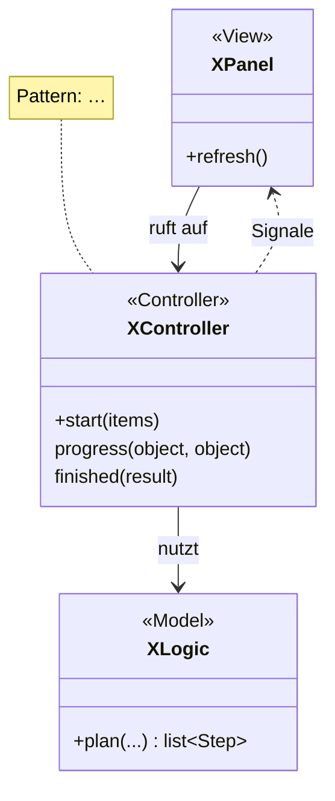
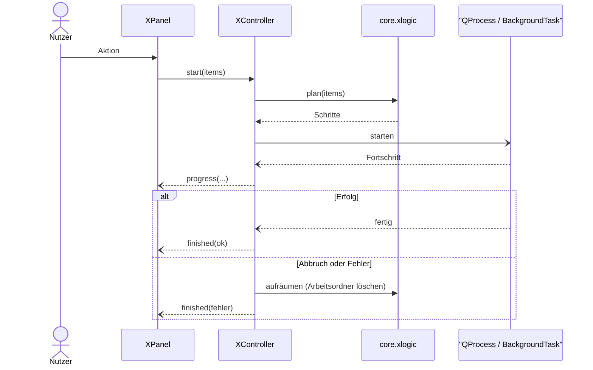

# <Feature-Name> (Reiter „<Reitertitel>“)

<Ein bis zwei Sätze: Wozu dient das Feature, was hat der Nutzer davon?>

Verwandte Docs: [specs/<spec>.md](../specs/<spec>.md) · [ADR <nr>](../adr/<datei>.md)

## Bedienung

- <Liste/Anzeige: was wird angezeigt, welche Filter/Spalten>
- **<Aktion 1>:** <was passiert, aus Nutzersicht>
- **<Aktion 2>:** …

## Aufbau

<Ein Satz zum Pattern, z. B. „Die Tabelle erbt von `GameTableModel` (Template Method); Spalten über `columns()`.“>

| Schicht | Datei | Rolle |
|---|---|---|
| View | `widgets/<panel>.py` | … |
| Item-Model | `widgets/models/<model>.py` | … |
| Controller | `controllers/<controller>.py` | … |
| Model | `core/<modul>.py` | … |

## Ablauf

## Dateien und Ablage

- Arbeitsordner: `<HDD>/.retro-manager-tmp/<feature>/…`
- Ergebnis: <wohin, nach welcher Regel; Verweis auf specs/library.md>
- Manifest: <falls vorhanden>

## Konfiguration

| INI | Bedeutung | Standard |
|---|---|---|
| `[<abschnitt>] <schlüssel>` | … | … |

## Fehler und Abbruch

- <Was passiert bei Abbruch, Fehler, Konflikt mit vorhandenen Dateien>

## Status

- **Real getestet:** <womit, mit welchen Testdaten>
- **Noch offen:** siehe [Roadmap](../roadmap.md) (nur dort eintragen)
