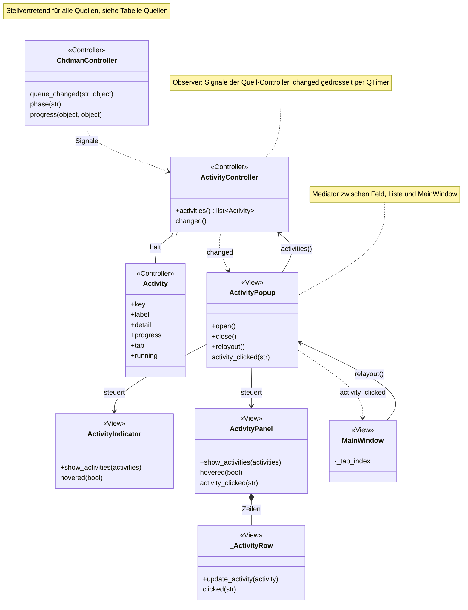
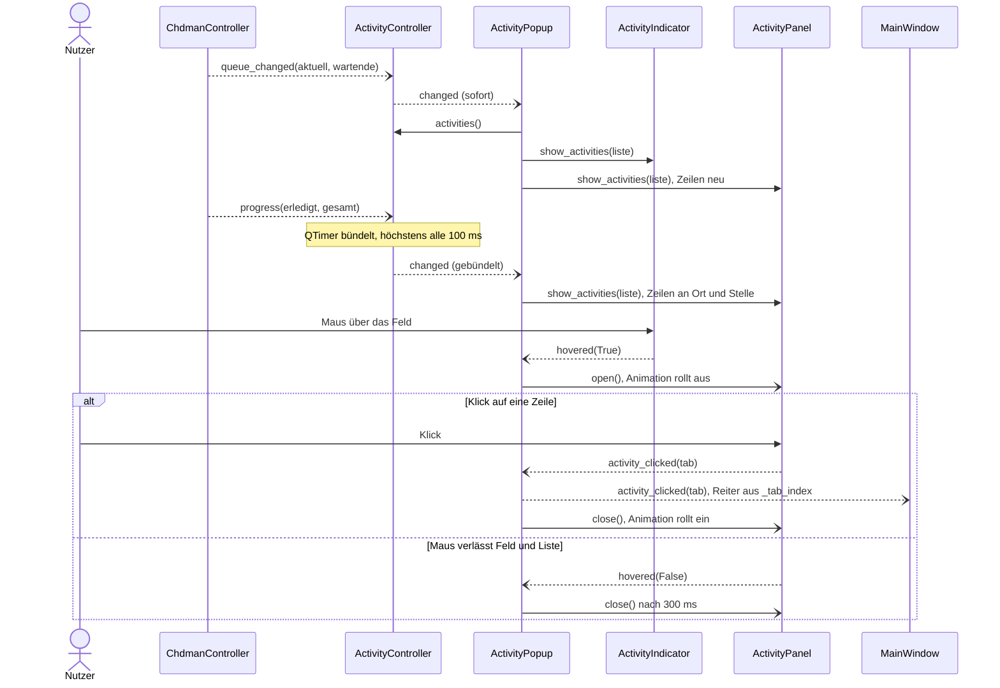

# Aktivitätsanzeige (Banner oben rechts)

Sobald irgendein Hintergrundvorgang läuft oder wartet, erscheint oben rechts im Banner ein Feld mit dem ersten Vorgang. Beim Überfahren rollt eine Liste aller Vorgänge bis zum unteren Fensterrand aus; ein Klick auf einen Vorgang wechselt in den zuständigen Reiter. So sieht der Nutzer aus jedem Reiter, was gerade arbeitet.

Verwandte Docs: [architecture.md](../architecture.md#nebenläufigkeit) · Quellen: [igir](igir.md) · [dats](dats.md) · [chdman](chdman.md) · [archive](archive.md) · [export](export.md) · [ftp](ftp.md)

## Bedienung

- **Feld im Banner** (`ActivityIndicator`, 380 px breit): Drehsymbol, Titel und Detail des ersten Vorgangs (gekürzt mit „…“; bei einem wartenden Vorgang „wartet“), Fortschrittsbalken (unbestimmt, wenn kein Fortschritt bekannt) und „+N“ für weitere Vorgänge (Tooltip „N weitere Vorgänge“). Ohne Vorgänge unsichtbar.
- **Überfahren des Felds:** Die Liste (`ActivityPanel`) rollt rechtsbündig unter dem Banner bis zur Unterkante des Fensters aus (~180 ms). Sie schwebt über der Arbeitsfläche (nicht im Layout) und passt sich bei Größenänderung des Fensters an. Sie rollt ~300 ms, nachdem die Maus Feld und Liste verlassen hat, wieder ein; ebenso, sobald kein Vorgang mehr da ist.
- **Zeile der Liste:** Titel, Zustand „läuft“ / „wartet“; bei laufenden Vorgängen zusätzlich Detail (falls vorhanden) und Fortschrittsbalken. Bei reinem Fortschritt werden die Zeilen an Ort und Stelle aktualisiert (kein Flackern, Klicks gehen nicht verloren); kommen Vorgänge hinzu oder fallen weg, wird die Liste neu aufgebaut.
- **Klick (linke Maustaste) auf eine Zeile:** wechselt in den zuständigen Reiter und rollt die Liste ein.

### Quellen

| Quelle | Signale | Einträge | Titel / Detail | Reiter |
|---|---|---|---|---|
| Igir-Prüfung | `running_changed`, `output_line` | einer | „Igir: ROMs prüfen“ / letzte Ausgabezeile | igir |
| DATs aktualisieren | `running_changed`, `status`, `progress` | einer | „DATs aktualisieren“ / letzte Protokollzeile | igir |
| chdman | `queue_changed`, `phase`, `progress` | laufender Vorgang + je wartender einer | „chdman – \<Aktion\>: \<Spiel\>“ / Arbeitsschritt | chdman |
| Archive | `jobs_changed` | je laufender und je wartender Job einer | Job-Titel / Arbeitsschritt (`JobInfo.phase`) | archive |
| Aufbereiten | `queue_changed`, `status`, `progress` | laufende Disc + je wartende Disc einer | „Aufbereiten: \<Spiel\>“ / letzte Statuszeile, „[n/m] …“ als „Disc n von m“ | export |
| FTP-Warteschlange | `job_added`, `job_changed`, `job_finished` | je wartender und laufender Auftrag einer | „FTP ↑ \<Name\>“ bzw. „FTP ↓ …“ / „x MB / y MB“ während der Übertragung | ftp |

- Fortschritt = erledigt / gesamt (höchstens 100 %); neue Einträge beginnen ohne Fortschritt (unbestimmt).
- Reihenfolge: laufende Vorgänge zuerst, dann wartende, jeweils in der Reihenfolge ihres ersten Auftauchens; Wartende behalten ihren Platz.
- Neue und beendete Einträge sowie der Wechsel „wartet“ → „läuft“ werden sofort gemeldet, reiner Fortschritt bzw. Detailtext gebündelt (höchstens alle 100 ms, `_UPDATE_INTERVAL_MS`).

## Aufbau

`ActivityController` beobachtet die Signale der Quell-Controller (Observer) und hält eine geordnete Liste von `Activity`-Einträgen; `ActivityPopup` vermittelt zwischen Feld, Liste und Hauptfenster (Mediator), sodass `ActivityIndicator` und `ActivityPanel` einander nicht kennen.

| Schicht | Datei | Rolle |
|---|---|---|
| Controller | `controllers/activity_controller.py` | `ActivityController`: Signale der Quellen sammeln, Liste pflegen, `changed` gedrosselt melden; Datenklasse `Activity` (`key`, `label`, `detail`, `progress`, `tab`, `running`); Reiterschlüssel `TAB_IGIR`, `TAB_CHDMAN`, `TAB_ARCHIVE`, `TAB_EXPORT`, `TAB_FTP` |
| Controller | `controllers/igir_controller.py`, `dat_controller.py`, `chdman_controller.py`, `archive_controller.py` (mit `JobInfo`), `export_controller.py`, `transfer_controller.py` | Quellen (Signale siehe Tabelle oben) |
| View | `widgets/activity_indicator.py` | `ActivityIndicator` (Feld), `ActivityPanel` (Liste, Zeilen `_ActivityRow`), `ActivityPopup` (Ausrollen/Einrollen, Position, Klick weiterreichen) |
| View | `widgets/main_window.py` | `MainWindow`: Feld im Banner, Liste als Kind des zentralen Widgets, Reiterwechsel über `_tab_index`, `resizeEvent` → `ActivityPopup.relayout()` |
| – | `app.py` | erzeugt `ActivityController` mit allen Quell-Controllern und übergibt ihn an `MainWindow` |

Kein `core/`-Anteil: Die Anzeige arbeitet nur mit Controller-Signalen. Styling über `#activityIndicator`, `#activityPanel`, `#activityRow` u. a. in `resources/style.qss`.

### Neue Quelle anschließen

Ein neuer Hintergrundvorgang bietet im Controller passende Signale an (laufend/wartend, Detail, Fortschritt), wird im Konstruktor von `ActivityController` angeschlossen (in `app.py` übergeben) und nutzt dort `_toggle`/`_update`/`_remove` bzw. `_on_queue` für Warteschlangen. Ein neuer Reiter bekommt eine `TAB_*`-Konstante in `activity_controller.py` und einen Eintrag in `MainWindow._tab_index`.

## Ablauf

Beispiel chdman: Vorgang startet, meldet Fortschritt, der Nutzer öffnet die Liste und klickt.

## Fehler und Abbruch

- Die Anzeige selbst meldet keine Fehler; Fehlermeldungen stehen im Protokoll des jeweiligen Reiters (bei Aufbereiten erscheinen Statuszeilen wie „Fehler bei …“ auch als Detail).
- Einträge verschwinden, sobald die Quelle das Ende meldet: `running_changed(False)` (Igir, DATs), `queue_changed("", [])` (chdman, Aufbereiten), `jobs_changed([], [])` bzw. fehlende Jobs (Archive), `job_finished` oder ein Zustand außer „wartet“/„läuft“ (FTP) – also auch nach Abbruch und Fehler.

## Status

- **Real getestet:** mehrere gleichzeitige Quellen, Klick mit Reiterwechsel.
- **Noch offen:** siehe [Roadmap](../roadmap.md#noch-nicht-real-getestet) (nur dort eintragen)
