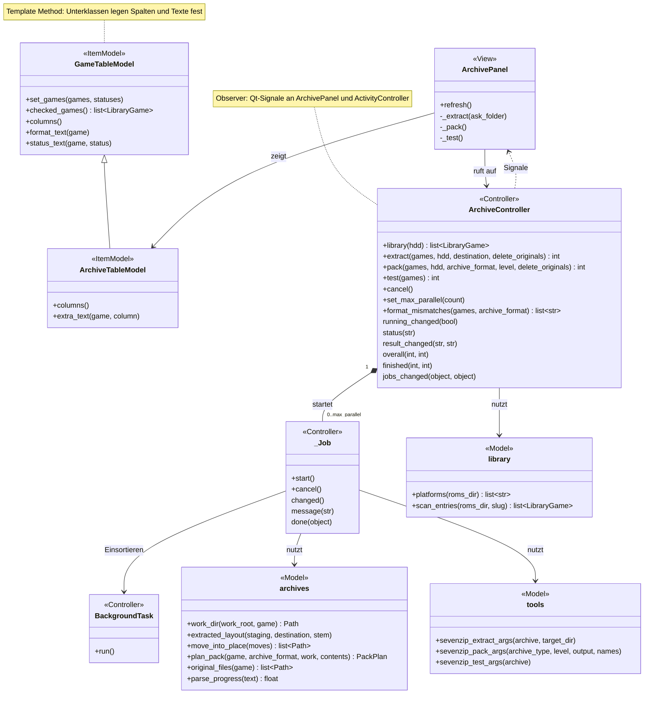
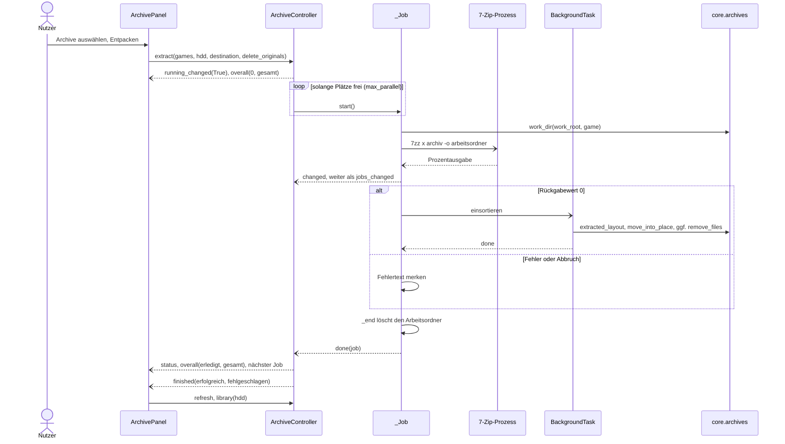
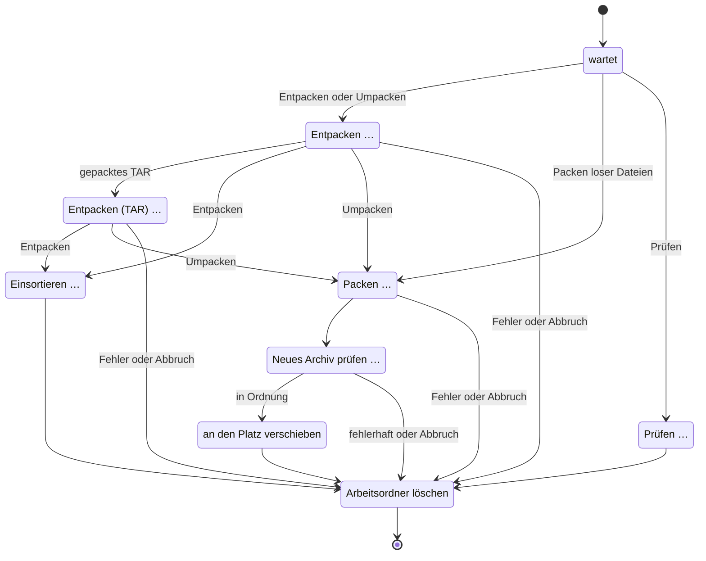

# Archive (Reiter „Archive“)

Entpacken, Packen und Prüfen von Archiven mit 7-Zip, mehrere Einträge gleichzeitig. So lassen sich heruntergeladene Archive in die Bibliothek einsortieren und lose ROMs bzw. Disc-Images in das Archivformat ihres Systems bringen. CHD-Dateien erzeugt und entpackt der [chdman-Reiter](chdman.md) – 7-Zip liest kein CHD.

Verwandte Docs: [specs/7zip.md](../specs/7zip.md) · [specs/library.md](../specs/library.md) · [specs/configuration.md](../specs/configuration.md) · [ADR 0007](../adr/0007-7zip-as-archive-tool.md) · [ADR 0010](../adr/0010-single-library-scan.md) · [Aktivitätsanzeige](activity.md)

## Bedienung

- **Liste:** vorerst nur die Bibliothek – alle Einträge aller Plattformordner unter `roms/` (`library.platforms` + `library.scan_entries`): Archive, BIN/CUE, GDI, ISO, CHD und einzelne ROM-Dateien. Eingebundene Tracks und weitere Teile mehrteiliger Archive erscheinen nicht einzeln ([specs/library.md](../specs/library.md#einträge-lesen-corelibrarypy)). Die Liste wird beim Anzeigen des Reiters (außer während Jobs laufen), über **Liste aktualisieren** und nach jedem Durchlauf neu eingelesen.
- **Filter:** **System** (nur vorhandene Plattformordner) und **Anzeigen**: „Alle Einträge“, „Nur Archive“ (zum Entpacken/Prüfen), „Nur ungepackte“ (alles, was kein Archiv ist, zum Packen).
- **Spalten:**

| Auswahl | System | Spiel | Format | Größe | Zielformat | Prüfung |
|---|---|---|---|---|---|---|
| Kästchen | Plattform | Name, ggf. `Spielordner / Name` | Archivart (`7Z`, `TAR.GZ`, `RAR (3 Teile)`) bzw. Dateiart (`BIN/CUE`, `GB` …) | alle Teile bzw. Tracks | laut [Archivregeln](../specs/library.md#archivformat-je-system), `–` ohne Regel | „in Ordnung“ / „fehlerhaft“ nach **Prüfen** (nur für die laufende Sitzung) |

- **Entpacken** (nur ausgewählte Archive; andere werden übersprungen und im Protokoll gezählt): 7z, ZIP, RAR (auch `.partN.rar`, `.rNN`), `.7z.001`/`.zip.001`, TAR, TAR.GZ/BZ2/XZ, GZ/BZ2/XZ ([Archivnamen](../specs/7zip.md#archivnamen-corearchive_namespy)). Einsortiert wird neben das Archiv (`archives.extracted_layout`):
  - genau eine Datei → direkt neben das Archiv (z. B. `Tetris.gb`)
  - genau ein Ordner → dieser Ordner
  - mehrere Einträge → Spielordner `<Archivname>/` (Struktur A)
- **Entpacken nach …** – wie oben, aber in einen wählbaren Ordner.
- **Packen** – je Eintrag ein Archiv `<Name>.zip` bzw. `<Name>.7z` neben dem Original:
  - Gepackt wird die ROM-Datei, die CUE/GDI samt aller Tracks, die ISO bzw. CHD.
  - Ausgewählte Archive werden **umgepackt** (entpacken → packen), z. B. 7z → ZIP; gepackte TARs ebenfalls in zwei Schritten.
  - Weicht das Packformat vom Zielformat eines ausgewählten Systems ab (z. B. „PS1 → CHD“, aber auch „Game Boy → ZIP“ beim Packen als 7z), fragt die App nach (`ArchiveController.format_mismatches`). Systeme ohne Regel lösen keine Rückfrage aus.
- **Prüfen** (nur Archive) – `7zz t` rechnet alle Prüfsummen nach; Ergebnis in der Spalte „Prüfung“.
- **Optionen fürs Packen:** **Packformat** ZIP oder 7z, **Stufe** Schnell / Normal / Maximal (`-mx` 1 / 5 / 9, `archives.PACK_LEVELS`).
- **Originale nach Erfolg löschen** (gilt für Entpacken und Packen; Rückfrage vor dem Start, wenn angehakt): Nach erfolgreichem Einsortieren bzw. Verschieben wird das Original gelöscht (`archives.original_files`): bei Archiven alle Teile, bei CUE/GDI alle Tracks. Auch bei **Entpacken nach …** wird das Archiv in der Bibliothek gelöscht.
- **Gleichzeitig** (1–8) legt fest, wie viele Einträge parallel laufen; die Änderung gilt sofort, auch während eines Durchlaufs. Auf einer HDD ist mehr nicht immer schneller (Kopfspringen zwischen den Dateien); 1–2 ist meist ein guter Wert.
- **Fortschritt:** Unter den Knöpfen „x von y erledigt“ als Balken, darunter das Protokoll (`▶ Titel`, `[Name] → Ziel`, Fehler, Endstand „Fertig: x erfolgreich, y fehlgeschlagen.“). Jeder laufende und jeder wartende Job erscheint als eigene Zeile in der [Aktivitätsanzeige](activity.md) mit Arbeitsschritt und Prozent; Klick führt in diesen Reiter.
- Während eines Durchlaufs sind Liste, Filter, Optionen und Aktionen gesperrt; nur **Abbrechen** und **Gleichzeitig** bleiben bedienbar.
- **Fehlt 7-Zip**, erscheint ein Hinweis und die Aktionen sind gesperrt (Suchreihenfolge: [specs/7zip.md](../specs/7zip.md)).

## Aufbau

Die Tabelle erbt von `GameTableModel` (Template Method: `columns()`, `extra_text()`, `format_text()`, `status_text()`); der Controller meldet Zustände per Qt-Signal (Observer) an Panel und `ActivityController`. Je Eintrag gibt es ein eigenes `_Job`-Objekt mit eigenem 7-Zip-Prozess und Arbeitsordner; die Schritte eines Jobs sind über Rückrufe verkettet.

| Schicht | Datei | Rolle |
|---|---|---|
| View | `widgets/archive_panel.py` | `ArchivePanel`: Filter, Optionen, Knöpfe, Rückfragen, Protokoll |
| Item-Model | `widgets/models/archive_table_model.py` | `ArchiveTableModel`: Spalten Zielformat und Prüfung, Formattext für Archive |
| Item-Model | `widgets/models/game_table_model.py` | `GameTableModel`: gemeinsame Basis aller Spielelisten |
| Controller | `controllers/archive_controller.py` | `ArchiveController`: Warteschlange mit bis zu `max_parallel` Jobs; `_Job`: ein Eintrag (7-Zip per `QProcess`, Einsortieren per `BackgroundTask`) |
| Controller | `controllers/background_task.py` | `BackgroundTask`: Dateiarbeit im `QThreadPool` |
| Controller | `controllers/settings_controller.py` | Speichert Optionen und `max_parallel` in der INI |
| Model | `core/library.py` | Einträge der Bibliothek lesen |
| Model | `core/archives.py`, `core/archive_names.py` | Archive erkennen, Arbeitsordner, Einsortieren, Packplan, Originale, Fortschritt parsen |
| Model | `core/tools.py` | 7-Zip finden, Argumentlisten |
| Model | `core/formats.py` | Zielformat je System |

## Ablauf

Hauptablauf am Beispiel **Entpacken** (Packen und Prüfen siehe Zustandsdiagramm unten):

Arbeitsschritte eines Jobs (Phasentexte wie in der Aktivitätsanzeige):

## Dateien und Ablage

- Arbeitsordner je Eintrag: `<HDD>/.retro-manager-tmp/archive/<schlüssel>/` (`archives.work_dir`; Schlüssel = `LibraryGame.key`, Sonderzeichen wie `/` durch `_` ersetzt). Darin `entpackt/` (erster Schritt), `tar/` (zweiter Schritt bei gepackten TARs) und beim Packen `<Name>.<zip|7z>.part`. Reste eines abgebrochenen Laufs werden beim Start des Eintrags gelöscht.
- Ergebnis: neben dem Original im selben Ordner (Struktur A, [specs/library.md](../specs/library.md)) bzw. im gewählten Ordner bei **Entpacken nach …**. Weil der Arbeitsordner auf der HDD liegt, wird in die Bibliothek nur umbenannt.
- Kein Manifest.
- 7-Zip-Aufrufe, Rückgabewerte und Fortschrittsausgabe: [specs/7zip.md](../specs/7zip.md).

## Konfiguration

Die Optionen werden bei jeder Änderung in der INI gespeichert und beim Einlesen der Liste übernommen; Standardwerte: [specs/configuration.md](../specs/configuration.md#ini-abschnitte).

| INI | Bedienelement |
|---|---|
| `[archives] format` | Packformat |
| `[archives] level` | Stufe |
| `[archives] delete_originals` | Originale nach Erfolg löschen |
| `[jobs] max_parallel` | Gleichzeitig |

## Fehler und Abbruch

- Vorhandene Ziele werden nie überschrieben: Existiert das Ziel beim Einsortieren bzw. das Archiv `<Name>.<zip|7z>` schon vor dem Start, oder liegt der Eintrag bereits im gewählten Format vor, schlägt dieser Eintrag fehl. Ein leeres Archiv ist ebenfalls ein Fehler.
- 7-Zip-Rückgabewerte ungleich 0 (auch 1 = Warnung) gelten als Fehler; das Protokoll zeigt „Fehler bei <Name>: …“ mit den letzten aussagekräftigen Fehlerzeilen von 7-Zip. Schlägt **Prüfen** fehl, steht in der Spalte „fehlerhaft“.
- Bei Fehler oder Erfolg wird der Arbeitsordner des Eintrags gelöscht; das Original bleibt bei einem Fehler unberührt. Die übrigen Einträge laufen weiter.
- **Abbrechen** leert die Warteschlange und beendet laufende 7-Zip-Prozesse; deren Arbeitsordner werden gelöscht. Ein bereits laufendes Einsortieren bzw. Verschieben im Hintergrund wird zu Ende geführt. Abgebrochene Einträge zählen weder als erfolgreich noch als fehlgeschlagen. Beim Beenden der App wird ebenso abgebrochen.

## Status

- **Real getestet** mit 7-Zip 25.01 und Testdaten: 7z, ZIP mit mehreren Dateien, TAR.GZ, dreiteiliges `.7z.001` entpackt; ROMs und BIN/CUE als ZIP gepackt (bitgenau), 7z → ZIP umgepackt; zwei Jobs gleichzeitig; Zielkonflikte, beschädigtes Archiv, Abbruch mitten im Entpacken; „Entpacken nach …“ mit 7z.
- **Noch offen:** siehe [Roadmap](../roadmap.md#noch-nicht-real-getestet).
