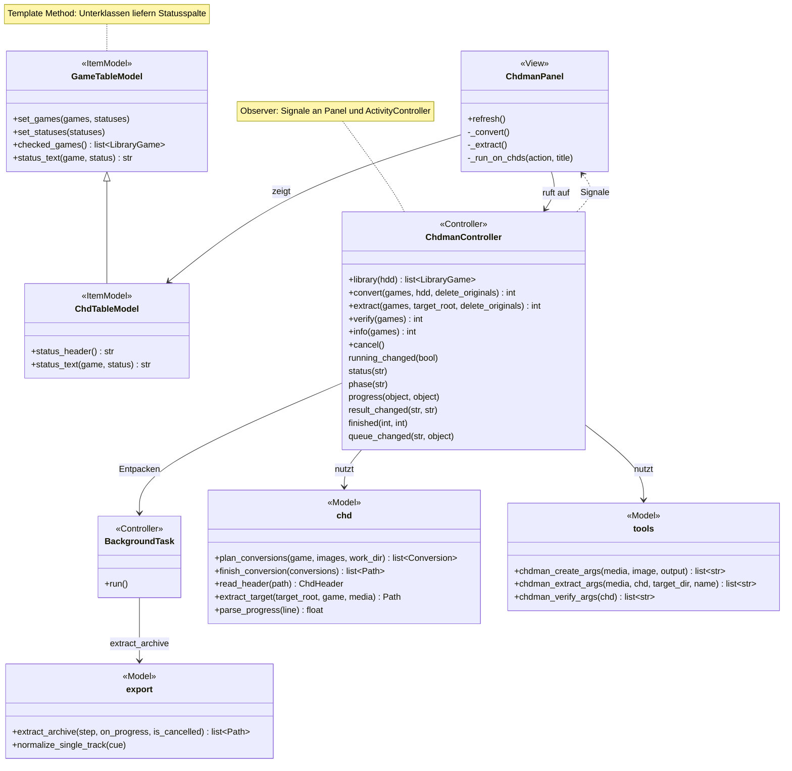
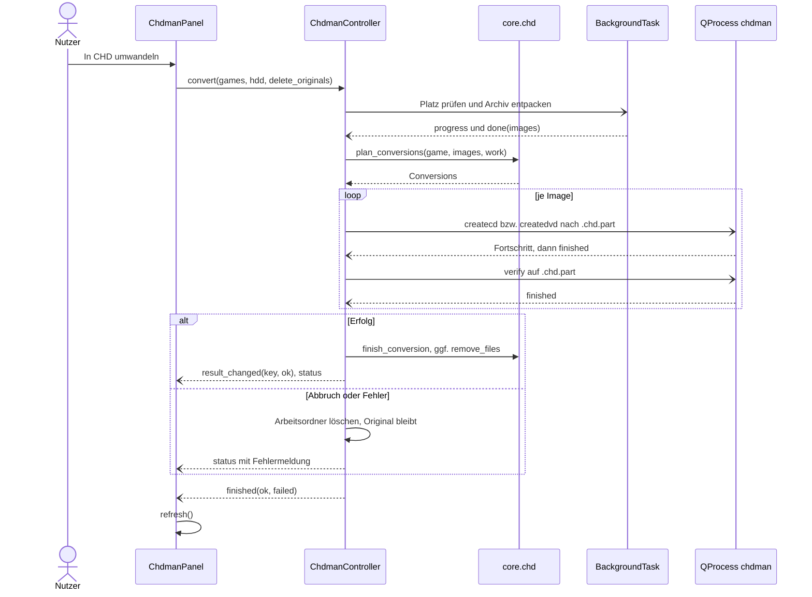
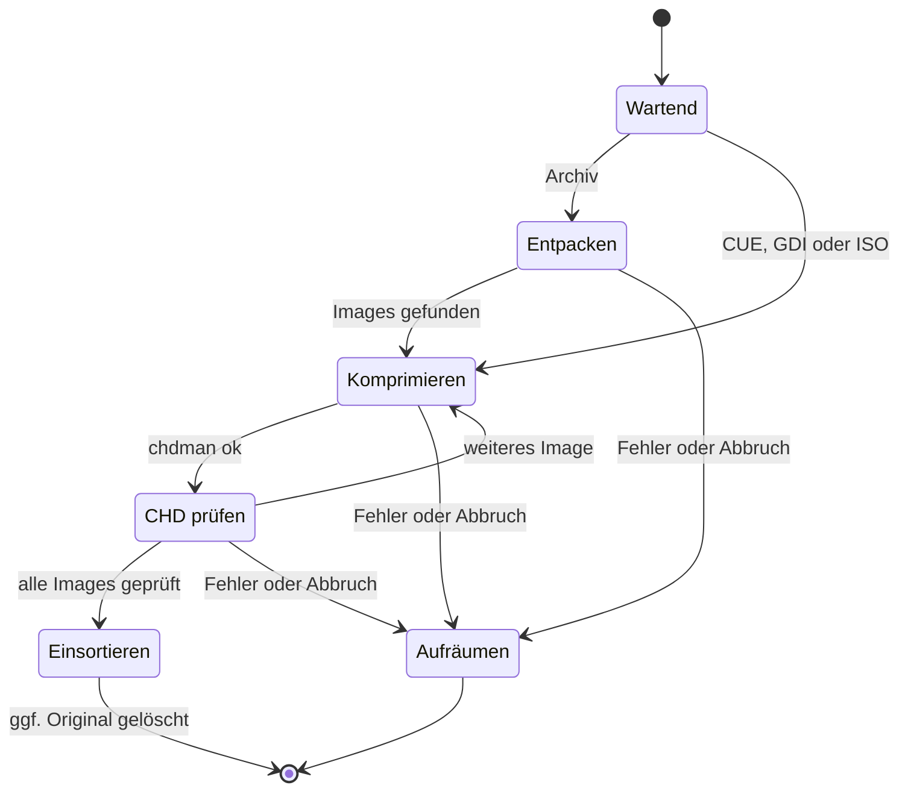

# chdman (Reiter „chdman“)

CHD fasst die Dateien einer Disc verlustfrei in einer komprimierten Datei zusammen; RomM und Emulatoren wie DuckStation, PCSX2, Flycast oder PPSSPP lesen sie direkt ([ADR 0006](../adr/0006-chd-for-disc-games.md)). Echte Hardware (webMAN, OPL, XStation …) braucht dagegen BIN/CUE bzw. ISO – dafür wandelt [„Export vorbereiten“](export.md) automatisch zurück.

Verwandte Docs: [specs/chdman.md](../specs/chdman.md) (Befehle, Ausgabe, CHD-Kopf) · [specs/library.md](../specs/library.md) · [ADR 0006](../adr/0006-chd-for-disc-games.md) · [ADR 0010](../adr/0010-single-library-scan.md)

## Bedienung

- **Liste:** alle Disc-Spiele aus `roms/<slug>/` der Systeme in `chd.CHD_PLATFORMS` (PS1, PS2, PSP, Dreamcast, Saturn, Sega CD, PC Engine CD, Neo Geo CD, 3DO, PC-FX, CD-i, Amiga CD32, Jaguar CD; nicht GameCube/Wii, Switch, PS3). Quelle ist `library.scan_platform`: Disc-Images (CHD, ISO, CUE, GDI) und 7z/ZIP-Archive; Größe = alle Tracks bzw. das Archiv ([specs/library.md](../specs/library.md#einträge-lesen-corelibrarypy)).
- Spalten Auswahl, System, Spiel, Format, Größe, **Prüfung** („in Ordnung“ / „fehlerhaft“, nur für die laufende Sitzung). Filter **System** zeigt „Alle Systeme“ und die vorhandenen Systeme; beim Wechsel des Filters entfällt die Auswahl ausgeblendeter Spiele.
- Die Liste wird beim Öffnen des Reiters (wenn nichts läuft), mit **Liste aktualisieren** und nach jedem Durchlauf neu eingelesen. **Alle auswählen** / **Keine** setzen die Häkchen.
- **In CHD umwandeln** (BIN/CUE, GDI, ISO, 7z/ZIP; CHDs in der Auswahl werden übersprungen):
  1. Archive werden in den Arbeitsordner entpackt (Platzprüfung vorher). Enthält ein Archiv mehrere Discs, entsteht je Image eine CHD mit dessen Namen; sonst heißt die CHD wie der Eintrag in der Bibliothek.
  2. `createcd` für CUE/GDI und CD-ISOs, `createdvd` für ISOs von PS2 und PSP (`chd.media_for_image`) – in `<name>.chd.part` im Arbeitsordner.
  3. `chdman verify` auf die neue Datei.
  4. Verschieben neben das Original (Struktur A).
  5. Original löschen (Archiv bzw. CUE/GDI samt aller Tracks bzw. ISO), wenn **„Originale nach erfolgreicher Prüfung löschen“** angehakt ist (Rückfrage vor dem Start).
- **Zurückwandeln …** (nur CHDs) in einen wählbaren Ordner. Die Medienart kommt aus dem CHD-Kopf (`chd.read_header`):

  | Medium | Ergebnis |
  |---|---|
  | CD (PS1, Saturn, PS2-Spiele auf CD …) | Ordner `<Spiel>/` mit BIN/CUE, ein BIN je Track; Einzelspur-Discs als `<Spiel>.bin` (`export.normalize_single_track`) |
  | GD-ROM (Dreamcast) | Ordner `<Spiel>/` mit GDI und einer Datei je Track |
  | DVD (PS2, PSP) | `<Spiel>.iso` direkt im Zielordner |

  War das Original eine CD als ISO, kommt sie als BIN/CUE zurück – für chdman ist es eine CD. Ergebnis sind lose Dateien, kein 7z. Mit gesetztem Haken wird die CHD nach erfolgreichem Zurückwandeln gelöscht (Rückfrage vorher).
- **Prüfen** (nur CHDs): `chdman verify` rechnet die gespeicherten SHA1-Prüfsummen nach; Ergebnis in der Spalte „Prüfung“.
- **Infos** (nur CHDs): Ausgabe von `chdman info` (Tracks, Kompression, SHA1) im Protokoll.
- **Abbrechen** beendet den laufenden Vorgang und verwirft die Warteschlange.
- Unter der Tabelle das Protokoll; darüber die aktuelle Disc (`[n/gesamt] Aktion: Spiel`), der Arbeitsschritt und ein Fortschrittsbalken. Während eines Durchlaufs sind Tabelle und Aktionen gesperrt.
- Fehlt chdman, erscheint ein Hinweis und alle Aktionen außer „Liste aktualisieren“ sind gesperrt (Suchreihenfolge: [specs/chdman.md](../specs/chdman.md)).
- CHDs lassen sich nicht im [Archive-Reiter](archive.md) entpacken – 7-Zip liest kein CHD.

## Aufbau

Die Tabelle erbt von `GameTableModel` (Template Method: `ChdTableModel` legt nur Überschrift und Text der Statusspalte fest); der Controller meldet alles per Qt-Signal an Panel und Aktivitätsanzeige (Observer).

| Schicht | Datei | Rolle |
|---|---|---|
| View | `widgets/chdman_panel.py` | `ChdmanPanel`: Liste, Filter, Rückfragen, Zielordner-Dialog, Protokoll |
| Item-Model | `widgets/models/chd_table_model.py` | `ChdTableModel`: Statusspalte „Prüfung“ aus `RESULT_OK` / `RESULT_BROKEN` |
| Controller | `controllers/chdman_controller.py` | `ChdmanController`: Warteschlange, chdman per `QProcess`, Entpacken per `BackgroundTask` |
| Controller | `controllers/settings_controller.py` | `save_chd_delete_originals` merkt sich den Haken |
| Model | `core/chd.py` | Plattformen, Umwandlung planen, Platzbedarf, CHD-Kopf, Fortschritt parsen, Zielordner beim Zurückwandeln |
| Model | `core/tools.py` | Pfad und Argumentlisten für chdman |
| Model | `core/export.py` | `extract_archive`, `estimated_size`, `free_space`, `normalize_single_track` (gemeinsam mit dem Export) |
| Model | `core/library.py` | `scan_platform`, `image_files` |

## Ablauf

Hauptablauf „In CHD umwandeln“ für ein Archiv (bei CUE/GDI/ISO entfällt das Entpacken):

Zustände einer Disc beim Umwandeln:

- Discs laufen nacheinander (`_next_operation`, angestoßen über `QTimer.singleShot(0, …)`); chdman nutzt beim Komprimieren selbst alle Kerne.
- Fortschritt: beim Entpacken in Bytes, bei chdman aus der „xx% complete“-Ausgabe (`chd.parse_progress`, als Promille); bis zur ersten Prozentangabe läuft der Balken unbestimmt. Arbeitsschritt („Entpacken …“, „Komprimieren: … “, „CHD prüfen: …“, „Zurückwandeln …“, „Infos lesen …“) und Warteschlange gehen auch an die [Aktivitätsanzeige](activity.md).
- Wurde mindestens eine CHD erzeugt, weist das Protokoll am Ende darauf hin, die Plattform in RomM neu einzulesen (Scan).

## Dateien und Ablage

- Arbeitsordner: `<HDD>/.retro-manager-tmp/chdman/<schlüssel>/` je Disc (`chd.game_work_dir`, Schlüssel = `LibraryGame.key` mit ersetzten Sonderzeichen); Archive werden nach `…/<schlüssel>/entpackt/` entpackt, Zwischendateien heißen `<name>.chd.part`. Reste eines früheren Laufs werden vor dem Start derselben Disc gelöscht.
- Platzbedarf (`chd.required_space`): bei Archiven das Doppelte der entpackten Größe, sonst die Größe des Images samt Tracks.
- Ergebnis: CHD neben dem Original in `roms/<slug>/[<Spielordner>/]` ([specs/library.md](../specs/library.md)); nur nach erfolgreichem `verify`.
- Zurückgewandelte Discs liegen außerhalb der Bibliothek im gewählten Ordner; kein Manifest.

## Konfiguration

| INI | Bedeutung | Standard |
|---|---|---|
| `[chdman] delete_originals` | Haken „Originale nach erfolgreicher Prüfung löschen“; gilt für Umwandeln (Original) und Zurückwandeln (CHD) | `true` |

Gespeichert sofort beim Umschalten ([specs/configuration.md](../specs/configuration.md#ini-abschnitte)).

## Fehler und Abbruch

- **Ziel-CHD existiert schon** (oder ein Archiv enthält mehrere Discs gleichen Namens): Die Disc schlägt mit Meldung fehl und zählt als „fehlgeschlagen“; bei Archiven fällt das erst nach dem Entpacken auf.
- **Kein Disc-Image** im Archiv, **zu wenig Platz**, chdman-Fehler beim Erzeugen oder Prüfen: Meldung „Fehler bei <Spiel>: …“ (bei chdman die aussagekräftigste Zeile, [specs/chdman.md](../specs/chdman.md#ausgabe)), Arbeitsordner wird gelöscht, das Original bleibt; danach geht es mit der nächsten Disc weiter.
- **Zurückwandeln:** Ist die CHD keine CD-, GD- oder DVD-CHD (Kopf nicht lesbar, keine Version 5, andere Medienart) oder liegt im Ziel schon `<Spiel>.cue`/`.gdi`/`.iso`, schlägt die Disc fehl. Scheitert chdman, werden die neu entstandenen Dateien und ein neu angelegter Spielordner entfernt.
- **Prüfen:** Rückgabewert ungleich 0 setzt „fehlerhaft“ und zählt als fehlgeschlagen.
- **Abbrechen:** beendet den chdman-Prozess bzw. das Entpacken, löscht den Arbeitsordner der laufenden Disc und verwirft die übrigen; das Protokoll meldet „Abgebrochen.“. Beim Beenden der App wird ebenfalls abgebrochen.
- Am Ende: „Fertig: n erfolgreich, m fehlgeschlagen.“

## Status

- **Real getestet** mit chdman 0.289 und Testdaten: PS1-7z mit zwei Tracks, PS2-ISO, Dreamcast-GDI → CHD → zurück bitgenau; beschädigte CHD wird erkannt; Abbruch während des Komprimierens; Löschen der CHD beim Zurückwandeln.
- **Noch offen:** siehe [Roadmap](../roadmap.md#noch-nicht-real-getestet).
