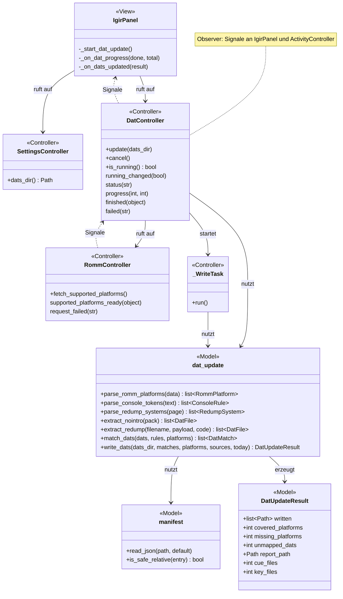
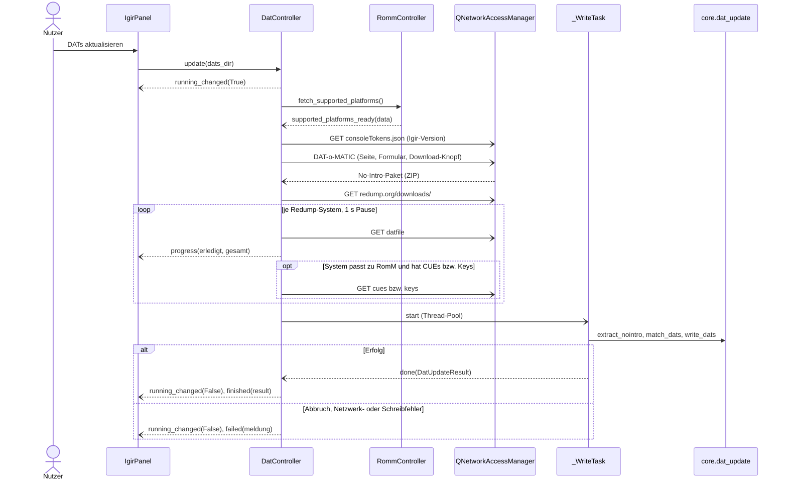

# DATs aktualisieren (Knopf im Reiter „Igir“)

Der Knopf **DATs aktualisieren** lädt die aktuellen DATs von No-Intro und Redump, behält nur die, die zu einer von RomM unterstützten Plattform passen, und legt sie in `<HDD>/dats/` ab. Dazu kommen korrekte Redump-CUEs (für die Prüfung von Disc-Spielen im [Igir-Reiter](igir.md)) und Redump-Disc-Keys (für PS3-Exporte, [features/export.md](export.md)).

Verwandte Docs: [specs/dat-sources.md](../specs/dat-sources.md) · [specs/igir.md](../specs/igir.md#plattform-tokens) · [specs/romm-api.md](../specs/romm-api.md) · [features/igir.md](igir.md)

## Bedienung

- **DATs aktualisieren** startet den Lauf. Voraussetzung: ein eingerichteter HDD-Ordner (sonst Meldung „Es ist noch kein HDD-Ordner eingerichtet.“) und eine Anmeldung der App bei RomM.
- Beim Start wird das Protokoll geleert; jeder Schritt erscheint dort als Zeile (z. B. „RomM kennt 120 Plattformen.“, „Redump: 3 Disc-Keys für …“).
- Der Balken zeigt beim Laden der Redump-DATs „erledigt / gesamt“, beim Zuordnen und Schreiben läuft er ohne Prozentangabe.
- Danach steht über der Tabelle eine Zusammenfassung: Anzahl geschriebener DATs, abgedeckte RomM-Plattformen, CUE-Dateien, Disc-Keys, RomM-Plattformen ohne DAT, DATs ohne Plattform und der Pfad zu `ABGLEICH.md`. Ist das Feld **DAT-Ordner** leer, wird `<HDD>/dats` eingetragen.
- **Abbrechen** (gemeinsamer Knopf mit der Igir-Prüfung) bricht die Downloads ab. Sperren der Knöpfe während des Laufs: [features/igir.md](igir.md#bedienung).
- Der Lauf erscheint in der [Aktivitätsanzeige](activity.md) („DATs aktualisieren“, Detail = letzte Protokollzeile).

## Aufbau

`DatController` arbeitet die Downloads als Kette von Antwort-Handlern nacheinander ab und meldet Zustand, Protokoll, Fortschritt und Ergebnis per Qt-Signal an `IgirPanel` und `ActivityController` (Observer). Auslesen, Zuordnen und Schreiben sind reine Funktionen in `core/dat_update.py`; das Schreiben läuft in `_WriteTask` (eigenes `QRunnable`) im globalen `QThreadPool`.

| Schicht | Datei | Rolle |
|---|---|---|
| View | `widgets/igir_panel.py` | `IgirPanel`: Knopf, Protokoll, Balken, Zusammenfassung (`_start_dat_update`, `_on_dats_updated`) |
| Controller | `controllers/dat_controller.py` | `DatController`: Ablauf, Downloads per `QNetworkAccessManager`, 1 s Pause per `QTimer`; `_WriteTask` im Thread-Pool |
| Controller | `controllers/romm_controller.py` | `RommController.fetch_supported_platforms` → `supported_platforms_ready` / `request_failed` |
| Controller | `controllers/settings_controller.py` | `dats_dir()` aus `[archive] hdd_path` |
| Model | `core/dat_update.py` | Adressen, Seiten auslesen, Pakete entpacken, `match_dats`, `write_dats`, `render_report`, Datenklassen |
| Model | `core/manifest.py` | `read_json`, `is_safe_relative` |



## Ablauf



Alle Zwischenstationen melden sich zusätzlich per `status(text)` im Protokoll. Adressen, Formular-Ablauf bei DAT-o-MATIC, Zeitlimit und Pause: [specs/dat-sources.md](../specs/dat-sources.md). RomM-Anfrage samt Token-Erneuerung: [specs/romm-api.md](../specs/romm-api.md).

Heruntergeladenes bleibt bis zum Schreiben im Speicher; vorher wird nichts unter `dats/` verändert. CUEs und Keys werden nur für Redump-Systeme geladen, deren DAT einer RomM-Plattform zugeordnet wurde.

## Zuordnung DAT → RomM-Plattform

`dat_update.match_dats` prüft je DAT (über den `<header><name>` der DAT) in dieser Reihenfolge; der erste Treffer gilt, die Art steht in `ABGLEICH.md`:

1. **`igir`:** Igirs Regeln aus `consoleTokens.json` – wie Igir gewinnt der **letzte** passende `datNameRegex` ([specs/igir.md](../specs/igir.md#plattform-tokens)). Nur wenn dessen `{romm}`-Token ein Slug ist, den RomM liefert.
2. **`manuell`:** feste Zuordnungen in `dat_update.MANUAL_MAPPINGS` für Systeme, für die Igir keinen RomM-Ordner kennt.
3. **`name`:** RomM-Plattformname im Systemteil des DAT-Namens (Text nach dem ersten „ - “, ohne „Parent Clone“, „BIOS“, „Datfile“); längere Namen zuerst, nur Namen ab 4 Zeichen. Bekannte Fehltreffer stehen in `dat_update.WRONG_NAME_MATCHES` („Capcom - Play System III“, „Naomi Satellite Terminal“).

DATs ohne Treffer werden nicht geschrieben.

## Dateien und Ablage

```
<HDD>/dats/
├── no-intro/                  # inkl. Unterordner Non-Redump/, Unofficial/
├── redump/                    # inkl. BIOS-DATs
├── redump-cues/<plattform>/   # gehört komplett der App, wird je Lauf ersetzt
├── redump-keys/<plattform>/   # gehört komplett der App, wird je Lauf ersetzt
├── ABGLEICH.md                # Abgleich mit RomM, wird je Lauf neu geschrieben
└── .retro-manager-dats.json   # Manifest der von der App geschriebenen DATs
```

- `<plattform>` ist der RomM-Slug (`fs_slug`), also der Ordnername unter `roms/` ([specs/library.md](../specs/library.md)). Die PS3-Keys liegen damit in `redump-keys/ps3/`.
- **Manifest:** JSON-Liste der relativen Pfade aller geschriebenen DATs. Zu Beginn des Schreibens löscht die App nur die darin aufgeführten Dateien (unsichere Einträge werden übergangen, `manifest.is_safe_relative`); **eigene DATs des Nutzers bleiben unberührt**. CUEs und Keys stehen nicht im Manifest, ihre Ordner werden vollständig gelöscht und neu angelegt.
- `ABGLEICH.md` hat drei Teile: je RomM-Plattform (`roms/<slug>`) die zugeordneten DATs mit Ordner und Art der Zuordnung; DATs ohne RomM-Plattform (nicht kopiert); RomM-Plattformen ohne DAT, gruppiert nach Kategorie. Kopf mit Datum und Quellenhinweis (`dat_controller.SOURCES_TEXT`, u. a. dass es für Nintendo Switch keine DAT gibt).
- Kein Arbeitsordner: Die Pakete werden im Speicher entpackt ([specs/dat-sources.md](../specs/dat-sources.md#entpacken-der-pakete)) und direkt nach `dats/` geschrieben.

## Konfiguration

Keine eigenen INI-Schlüssel. Zielordner ist `<[archive] hdd_path>/dats` (`config.dats_dir`, [specs/configuration.md](../specs/configuration.md)); die Version von `consoleTokens.json` folgt `tools.IGIR_VERSION`.

## Fehler und Abbruch

- **Abbruch des ganzen Laufs** mit Meldung unter den Knöpfen, wenn RomM nicht antwortet bzw. die App nicht angemeldet ist, wenn `consoleTokens.json`, eine DAT-o-MATIC-Seite oder die Redump-Systemliste nicht mit HTTP 200 kommt oder nicht auswertbar ist, wenn das No-Intro-Paket kein ZIP ist, bei Netzwerkfehlern (kein HTTP-Status) und wenn Redump keine Systeme liefert. `dats/` bleibt dann unverändert.
- **Einzelne Redump-DATs, CUE- oder Key-Pakete**, die fehlen oder beschädigt sind, werden nur im Protokoll vermerkt; der Lauf geht weiter.
- **Abbrechen** stoppt Pause-Timer und laufenden Download (`DatController.cancel`) und beendet den Lauf mit einer Meldung. Hat das Schreiben schon begonnen, wird es nicht mehr abgebrochen und läuft zu Ende.
- **Schreibfehler** (`OSError`, beschädigtes ZIP) melden „Schreiben fehlgeschlagen: …“; was bis dahin geschrieben bzw. gelöscht wurde, bleibt so.

## Status

- **Real getestet:** 265 DATs und 26 425 CUEs geladen und zugeordnet.
- **Noch offen:** siehe [Roadmap](../roadmap.md#noch-nicht-real-getestet).
