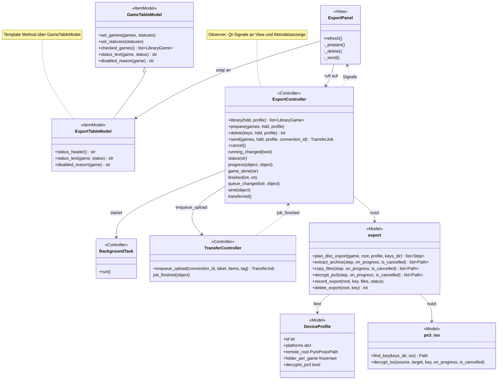
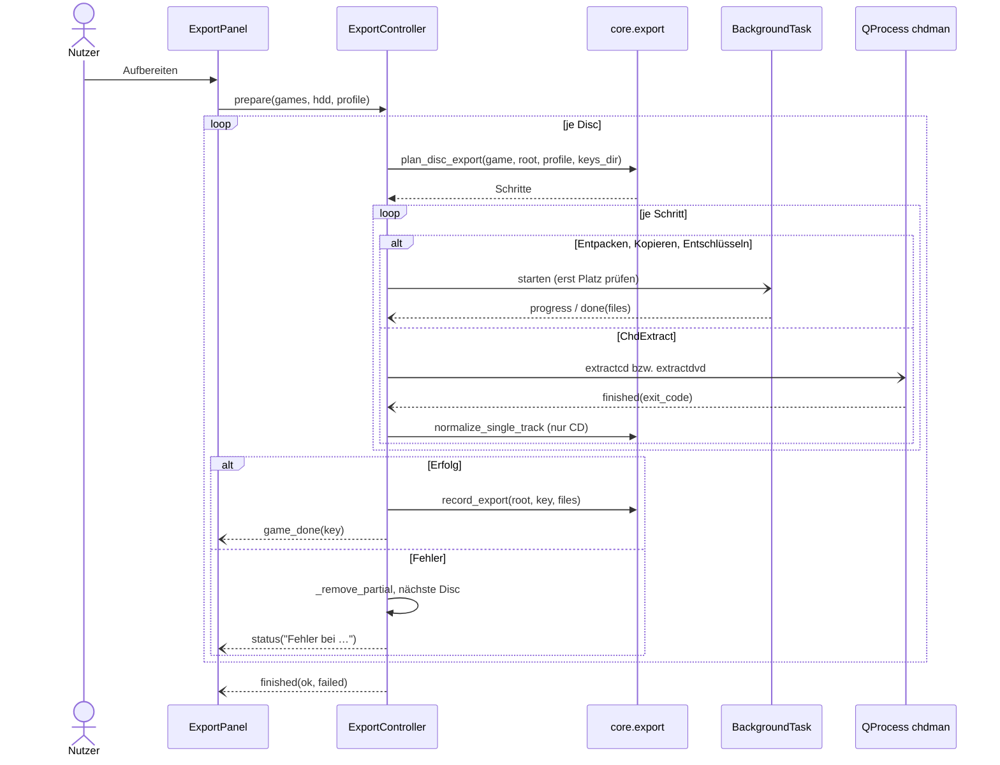
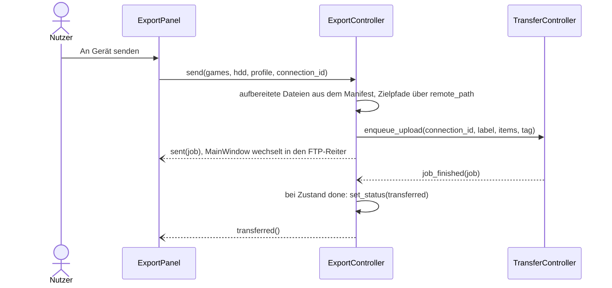

# Export vorbereiten (Reiter „Export vorbereiten“)

Das Archiv bleibt die eine saubere Quelle; für echte Hardware leitet die App daraus **Exporte im Format des Zielgeräts** ab. Sie liegen in einem eigenen, jederzeit löschbaren Ordner `<HDD>/exports/<profil>/` (von RomM ignoriert) und gehen über die Warteschlange des [FTP-Reiters](ftp.md) auf das Gerät. Erstes Zielgerät ist die PS3 mit CFW + webMAN MOD.

Verwandte Docs: [specs/library.md](../specs/library.md) · [specs/chdman.md](../specs/chdman.md) · [specs/ps3-iso.md](../specs/ps3-iso.md) · [specs/configuration.md](../specs/configuration.md) · [ADR 0009](../adr/0009-exports-as-derived-copies.md) · [features/ftp.md](ftp.md) · [features/activity.md](activity.md)

## Bedienung

- **Zielgerät** per Dropdown. Noch nicht umgesetzte Geräte (PS2 mit Open PS2 Loader, Xbox 360) stehen ausgegraut mit „– kommt später“ darin. Darunter: angebotene Systeme, ihre Ordner im Export und der Pfad des Export-Ordners; fehlt chdman, ein Hinweis.
- **Liste:** alle Disc-Spiele der Plattformen des Profils (`library.scan_platform`: Disc-Images und 7z/ZIP, [specs/library.md](../specs/library.md#einträge-lesen-corelibrarypy)) mit den Spalten Auswahl, System, Spiel, Format, Größe und **Export** („aufbereitet“ / „übertragen“). Ohne chdman sind CHD-Zeilen gesperrt (Tooltip „Für CHD-Dateien wird chdman benötigt.“). Die Liste wird beim Anzeigen des Reiters neu gelesen, außer während eines Laufs.
- **Liste aktualisieren**, **Alle auswählen**, **Keine.**
- **Aufbereiten:** arbeitet die ausgewählten Discs nacheinander ab; Fehler einzelner Discs brechen den Rest nicht ab. Fortschritt als Balken (bei chdman ohne Prozentangabe), aktuelle Disc als „[i/n] Name“, Meldungen im Protokoll darunter; am Ende „Fertig: x aufbereitet, y fehlgeschlagen.“ Während des Laufs sind alle anderen Schaltflächen, das Dropdown und die Tabelle gesperrt.
- **Abbrechen:** stoppt die laufende Disc und die restliche Liste.
- **Export löschen** (mit Rückfrage): entfernt nur die Dateien, die laut Manifest von der App geschrieben wurden, und danach leere Ordner; eigene Dateien im Export-Ordner bleiben.
- **Senden an / An Gerät senden:** Auswahl einer gespeicherten Verbindung aus dem FTP-Reiter (ohne Verbindung ist der Knopf gesperrt). Stellt die aufbereiteten Dateien der ausgewählten Spiele mit den Zielpfaden des Profils als **einen** Auftrag in die FTP-Warteschlange und wechselt in den FTP-Reiter. Noch nicht aufbereitete Spiele werden mit Hinweis übersprungen. Ist der Auftrag fertig, wird der Status „übertragen“.
- Aufbereiten und Senden sind zwei getrennte Schritte ([ADR 0009](../adr/0009-exports-as-derived-copies.md)).
- Laufende und wartende Discs erscheinen in der [Aktivitätsanzeige](activity.md).

## Aufbau

Die Tabelle erbt von `GameTableModel` (Template Method: `status_header`, `status_text`, `disabled_reason`); der Controller meldet Zustand und Fortschritt per Qt-Signal (Observer). Zielgeräte sind reine Daten (`DeviceProfile`, eingefrorene Dataclass) – keine Strategy: die Schritte plant `export.plan_disc_export` für alle Profile, gesteuert über die Felder des Profils. Ein Plan ist eine Liste von Schritt-Datenobjekten (`ExtractArchive`, `CopyFiles`, `ChdExtract`, `DecryptPs3`), die der Controller nacheinander ausführt.

| Schicht | Datei | Rolle |
|---|---|---|
| View | `widgets/export_panel.py` | `ExportPanel`: Zielgerät, Tabelle, Knöpfe, Protokoll, Verbindungsauswahl |
| Item-Model | `widgets/models/export_table_model.py` | `ExportTableModel`: Statusspalte „Export“, sperrt CHDs ohne chdman |
| Controller | `controllers/export_controller.py` | `ExportController`: Warteschlange, Schritte ausführen, Manifest führen, Senden |
| Controller | `controllers/background_task.py` | `BackgroundTask`: Python-Schritte im `QThreadPool` |
| Controller | `controllers/transfer_controller.py` | `TransferController.enqueue_upload`, Signal `job_finished` |
| Model | `core/devices.py` | `DeviceProfile`, `PROFILES`, `get_profile`, `export_root`, `target_dir`, `remote_path` |
| Model | `core/export.py` | Plan (`plan_disc_export`), Ausführung, Platzbedarf, Export-Manifest |
| Model | `core/ps3_iso.py` | Disc-Key finden und lesen, ISO entschlüsseln |
| Model | `core/manifest.py`, `core/progress.py` | JSON lesen/schreiben, Pfadschutz; Fortschritt, `ExportError`, `ExportCancelled` |
| Model | `core/tools.py` | `chdman_extract_args` |



## Ablauf

Aufbereiten:



An Gerät senden:



## Quellen und Schritte

`export.plan_disc_export` wählt je Disc die Schritte nach Art (`LibraryGame.kind`):

| Quelle | Schritt |
|---|---|
| 7z / ZIP | entpacken (ZIP über `zipfile`, 7z über `py7zr` mit eigener `WriterFactory`, damit „Abbrechen“ im Entpack-Thread greift); Einträge mit `..` oder absolutem Pfad ergeben einen Fehler |
| ISO | kopieren |
| BIN/CUE | CUE samt aller eingebundenen BINs kopieren |
| CHD | chdman zurückwandeln (Befehle: [specs/chdman.md](../specs/chdman.md#befehle)): PS2 und PSP als DVD (`extractdvd`), sonst als CD (`extractcd --splitbin`). Schlägt `extractdvd` fehl, folgt einmal `extractcd` (PS2-Spiele auf CD). Einzelspur-Discs werden auf den Redump-Namen umbenannt (`export.normalize_single_track`, [specs/chdman.md](../specs/chdman.md#befehle)). |
| PS3-ISO bzw. PS3-Archiv mit Disc-Key | entschlüsseln, Archive vorher entpacken (siehe Profil PS3) |

## Profil PS3 (CFW + webMAN MOD)

Profil `PS3_WEBMAN` (ID `ps3`) in `core/devices.py`. Plattformen PS1, PS2, PS3, PSP aus `roms/{psx,ps2,ps3,psp}`; Ordner im Export und auf dem Gerät (unter `/dev_hdd0/`, `remote_root`) wie webMAN sie erwartet:

| Plattform | Ordner | Inhalt |
|---|---|---|
| PS1 | `PSXISO/<Spiel>/` | BIN/CUE, ein Ordner je Spiel (`folder_per_game`; Name = Spielordner in `roms/`, sonst Spielname) |
| PS2 | `PS2ISO/` | ISO (bzw. BIN/CUE bei CD-Spielen aus CHD) |
| PS3 | `PS3ISO/` | ISO (entschlüsselt) |
| PSP | `PSPISO/` | ISO |

- Pfad auf dem Gerät = `remote_root` + Pfad relativ zum Export-Ordner (`devices.remote_path`), z. B. `/dev_hdd0/PSXISO/Spiel/Spiel.cue`.
- Übertragung über das FTP von webMAN (FTP, Port 21, anonym); die Verbindung legt der Nutzer im [FTP-Reiter](ftp.md) an.
- **PS3-ISOs** (`decrypts_ps3`): Redump-Dumps sind verschlüsselt. Liegt in `<HDD>/dats/redump-keys/ps3/` ein Disc-Key zum Namen der Datei ([specs/ps3-iso.md](../specs/ps3-iso.md#disc-key)), wird die ISO beim Aufbereiten entschlüsselt (`DecryptPs3`). Archive werden dafür zuerst nach `PS3ISO/.entpacken/<Spiel>/` entpackt (`export.PS3_UNPACK_DIRNAME`), alle ISOs darin entschlüsselt und der Entpack-Ordner danach gelöscht. Ohne Key wird die ISO bzw. das Archiv unverändert übernommen, mit Hinweis im Protokoll (Einschränkungen: [specs/ps3-iso.md](../specs/ps3-iso.md#einschränkungen)). Die Keys lädt [„DATs aktualisieren“](dats.md).

## Dateien und Ablage

- Export-Ordner: `<HDD>/exports/<profil-id>/` (`config.exports_dir`, `devices.export_root`), darin die Ordner des Profils (`devices.target_dir`). Geschrieben wird direkt dorthin, nicht in den Arbeitsordner `.retro-manager-tmp/`; Ausnahme `PS3ISO/.entpacken/` ist ein bekanntes Problem ([architecture.md](../architecture.md#dateien-und-bibliothek)).
- Manifest `exports/<profil-id>/.retro-manager-export.json`, je Disc unter ihrem Schlüssel (`LibraryGame.key`, [specs/library.md](../specs/library.md#einträge-lesen-corelibrarypy)) die geschriebenen Dateien relativ zum Export-Ordner und der Status:

```json
{"version": 1, "games": {"psx/Spiel.7z": {"files": ["PSXISO/Spiel/Spiel.bin", "PSXISO/Spiel/Spiel.cue"], "status": "prepared"}}}
```

- Status `prepared` („aufbereitet“) nach `record_export`, `transferred` („übertragen“) nach erfolgreichem FTP-Auftrag (`set_status`). Ein fehlendes oder kaputtes Manifest gilt als leer; Einträge mit `..` oder absolutem Pfad werden ignoriert (`manifest.is_safe_relative`).

## Konfiguration

- Gewähltes Zielgerät und Verbindung für „An Gerät senden“: INI `[export] device`, `connection` ([specs/configuration.md](../specs/configuration.md#ini-abschnitte)), gespeichert bei jeder Änderung über `SettingsController.save_export_device` bzw. `save_export_connection`. Eine unbekannte oder nicht verfügbare Geräte-ID ergibt das Standardprofil PS3 (`devices.get_profile`).
- chdman wird beim Start gesucht ([specs/chdman.md](../specs/chdman.md)); fehlt es, sind CHD-Einträge gesperrt.

## Fehler und Abbruch

- Vor jedem Entpack-, Kopier- und Entschlüsselungsschritt wird im Hintergrund der Platz geprüft (`export.estimated_size` gegen `export.free_space`); reicht er nicht, schlägt die Disc mit „Nicht genug Platz im Export-Ordner …“ fehl.
- Schlägt ein Schritt fehl (kaputtes Archiv, unsicherer Pfad, ungültiger Disc-Key, keine ISO im Archiv, chdman-Fehler …), entfernt der Controller die Dateien dieser Disc, die im Zielordner des Schritts neu entstanden sind oder in früheren Schritten erzeugt wurden (`_remove_partial`), meldet „Fehler bei <Spiel>: …“ und macht mit der nächsten Disc weiter. Das Manifest bleibt unverändert.
- **Abbrechen** setzt ein `threading.Event`, das die Python-Schritte je Block prüfen; ein laufendes chdman wird beendet (`kill`). Danach wird wie bei einem Fehler aufgeräumt und die restliche Liste verworfen.
- Beim Beenden der App wird ein laufender Export abgebrochen (`app.aboutToQuit` → `ExportController.cancel`).

## Status

- **Real getestet:** PS1 (7z → BIN/CUE) und PS2 (7z → ISO) bitgenau gegen Redump, Abbrechen, Export löschen, Senden an einen lokalen FTP-Testserver mit Status „übertragen“.
- **Noch offen:** siehe [Roadmap](../roadmap.md#noch-nicht-real-getestet).
