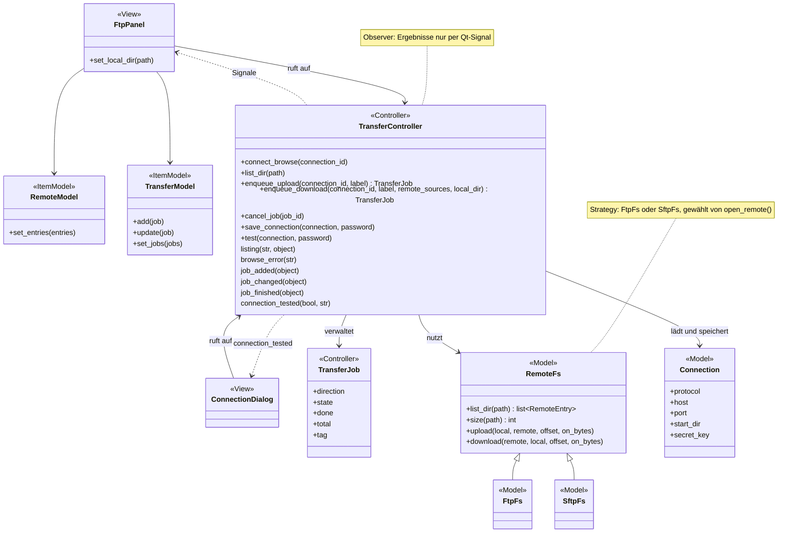
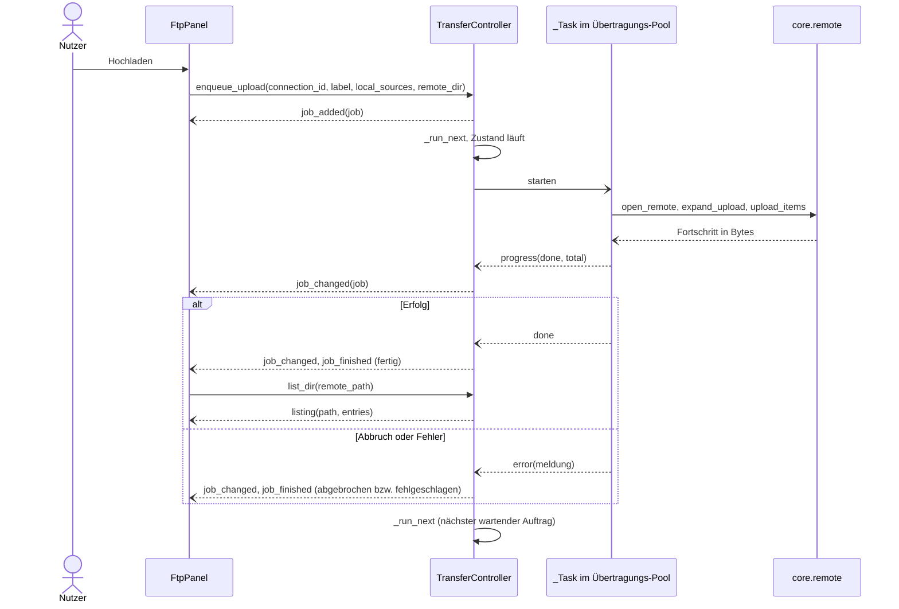
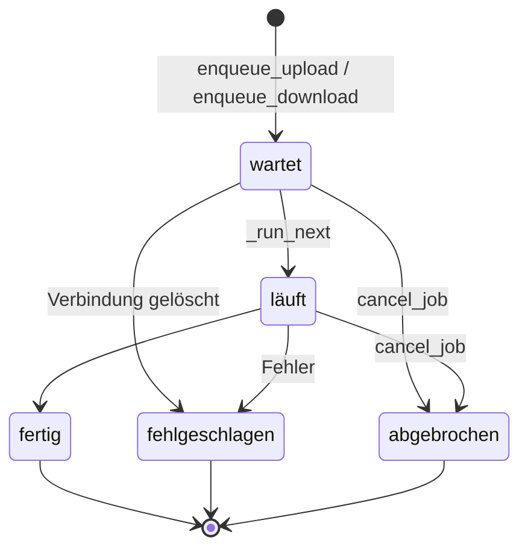

# FTP (Reiter „FTP“)

Zweiteiliger Dateimanager (links lokal, rechts das Gerät) mit Übertragungs-Warteschlange. Nutzbar für alle Geräte mit FTP, FTPS oder SFTP – Konsolen ebenso wie NAS oder PC. Der Reiter [„Export vorbereiten“](export.md) schickt seine Aufträge hierher.

Verwandte Docs: [specs/configuration.md](../specs/configuration.md) · [features/export.md](export.md) · [features/activity.md](activity.md)

## Bedienung

- **Kopfzeile:** Auswahl der gespeicherten Verbindung („Name (PROTOKOLL)“), „Verbinden“/„Trennen“, „Verwalten …“ und der Verbindungsstatus. Gibt es noch keine Verbindung, öffnet „Verbinden“ die Verwaltung.
- **Links „Lokal“:** Ordnerbaum (`QFileSystemModel`) mit Pfadfeld und „↑ Hoch“; Doppelklick öffnet einen Ordner. Beim ersten Anzeigen startet er in `<HDD>/exports`, falls vorhanden, sonst im Home-Ordner.
- **Rechts „Gerät“:** Inhalt des aktuellen Ordners (Name, Größe, Geändert; Ordner vor Dateien) mit Pfadfeld und „↑ Hoch“; Doppelklick öffnet einen Ordner. Nach dem Verbinden steht er im Startordner der Verbindung.
- **Hochladen →:** die links markierten Dateien und Ordner (rekursiv) in den rechts angezeigten Ordner.
- **← Herunterladen:** die rechts markierten Dateien und Ordner (rekursiv) in den links angezeigten Ordner.
- **Neuer Ordner, Umbenennen** (genau ein Eintrag), **Löschen** (nach Rückfrage; Ordner samt Inhalt), **Aktualisieren** – alles im rechts angezeigten Ordner. Danach wird er neu gelesen.
- **Warteschlange** unten: je Auftrag Name, Richtung, Fortschrittsbalken mit „erledigt / gesamt“ und Status (wartet, läuft, fertig, Fehler, abgebrochen; die Meldung als Tooltip). „Auftrag abbrechen“ wirkt auf die markierten Aufträge, „Erledigte entfernen“ räumt alle nicht mehr wartenden bzw. laufenden weg. Nach einem Hochlade-Auftrag über die gerade durchsuchte Verbindung wird der rechte Ordner neu gelesen.
- Jeder Auftrag erscheint außerdem in der [Aktivitätsanzeige](activity.md).

### Verbindungen verwalten („Verwalten …“)

`ConnectionDialog`: links die Liste, rechts Name, Protokoll (FTP, FTPS, SFTP), Adresse, Port, Benutzer (leer = anonym, nur FTP/FTPS), Passwort und Startordner.

- **Neu** legt sofort eine Verbindung „Neue Verbindung“ an; **Speichern** übernimmt die Eingaben (Adresse ist Pflicht; leerer Name → Adresse; leerer Startordner → `/`). Ein leeres Passwortfeld lässt das gespeicherte Passwort unverändert (Platzhalter „unverändert“).
- Ein Wechsel des Protokolls setzt den Port auf den Standard (FTP/FTPS 21, SFTP 22).
- **Testen** verbindet sich mit den aktuellen Eingaben (ohne zu speichern) und zeigt die Begrüßung des Servers bzw. den Fehler.
- **Löschen** nach Rückfrage; war es die gerade durchsuchte Verbindung, wird getrennt.
- Ablage: Verbindungen in der INI, Passwörter im Schlüsselbund, SFTP-Host-Keys in `known_hosts` – siehe [specs/configuration.md](../specs/configuration.md#ablageorte).
- Gibt es beim Start noch keine Verbindung, wird eine früher gespeicherte PS3-Adresse (`[ps3]`) als Verbindung „PS3“ (FTP, Startordner `/dev_hdd0`) übernommen (`connections.migrate_ps3_target`).

## Aufbau

`RemoteFs` ist eine abstrakte Schnittstelle (ABC) mit den Umsetzungen `FtpFs` und `SftpFs`; `remote.open_remote` wählt je Protokoll die passende (Strategy mit Factory-Funktion). Ergebnisse gehen per Qt-Signal an die Views (Observer).

| Schicht | Datei | Rolle |
|---|---|---|
| View | `widgets/ftp_panel.py` | `FtpPanel`: beide Seiten, Aktionsknöpfe, Warteschlange (Fortschrittsbalken per `_ProgressDelegate`) |
| View | `widgets/connection_dialog.py` | `ConnectionDialog`: Verbindungen anlegen, bearbeiten, testen, löschen |
| Item-Model | `widgets/models/remote_model.py` | `RemoteModel`: Einträge des Ordners auf dem Gerät |
| Item-Model | `widgets/models/transfer_model.py` | `TransferModel`: Aufträge der Warteschlange |
| Controller | `controllers/transfer_controller.py` | `TransferController`: Verbindungen, Durchsuchen, Warteschlange; `TransferJob` ist ein Auftrag |
| Model | `core/remote.py` | `RemoteFs`, `FtpFs`, `SftpFs`, `open_remote`; mehrere Dateien: `expand_upload`, `expand_download`, `upload_items`, `download_items`, `remove_tree`, `ensure_dirs` |
| Model | `core/connections.py` | `Connection`, Laden/Speichern der INI-Abschnitte, PS3-Übernahme, Pfad von `known_hosts` |
| Model | `core/credentials.py` | Passwörter im Schlüsselbund |

## Ablauf

Hochladen aus dem Reiter (der Export ruft `enqueue_upload` mit fertiger Liste `items` auf, siehe [export.md](export.md)):

Durchsuchen (`connect_browse`, `list_dir`, `mkdir`, `rename`, `delete`) läuft genauso als `_Task`, aber im Durchsuch-Pool; jeder Befehl endet mit `listing` (neu gelesener Ordner) oder `browse_error`.

### Auftragszustände

## Übertragung

- **Zwei Verbindungen, zwei Pools:** Durchsuchen und Warteschlange haben je eine eigene Verbindung und einen eigenen `QThreadPool` mit einem Thread. Befehle einer Verbindung laufen so nacheinander, und eine laufende Übertragung blockiert das Durchsuchen nicht. Die Durchsuch-Verbindung bleibt offen bis „Trennen“; jeder Auftrag öffnet und schließt seine eigene.
- **Warteschlange:** Aufträge laufen nacheinander in der Reihenfolge des Einstellens. Ein Auftrag ist entweder Hochladen (fertige Liste Datei → Zielpfad wie beim Export, oder Dateien/Ordner rekursiv unter einen Zielordner) oder Herunterladen (Dateien/Ordner rekursiv in einen lokalen Ordner). `tag` gibt dem Auftraggeber einen Rückbezug (Export-Schlüssel).
- **Fortsetzen:** Je Datei wird die vorhandene Zielgröße bestimmt. Gleich groß → übersprungen, kleiner → ab dieser Stelle fortgesetzt, größer → neu geschrieben. Danach muss die Zielgröße der Quelle entsprechen, sonst schlägt der Auftrag fehl.
- **Hochladen:** fehlende Zielordner werden angelegt (`ensure_dirs`; ein fehlgeschlagenes Anlegen wird ignoriert, das Schreiben scheitert dann).

## Technik

Protokolldetails (FTPS-Art, MLSD/LIST, `TYPE I` vor `SIZE`, Fortsetzen, SFTP-Anmeldung und Host-Keys, Zeitlimit): [specs/remote.md](../specs/remote.md).

## Fehler und Abbruch

- **Abbrechen eines laufenden Auftrags** setzt ein `threading.Event`, das bei jedem übertragenen Block geprüft wird. Teildateien bleiben liegen (auf dem Gerät bzw. lokal) und werden beim nächsten Auftrag fortgesetzt; Status „Abgebrochen – beim nächsten Mal wird fortgesetzt.“
- Ein wartender Auftrag wird sofort abgebrochen. Gibt es die Verbindung eines wartenden Auftrags nicht mehr, schlägt er fehl.
- Fehler eines Auftrags landen im Status (Tooltip) und im Log; Fehler beim Durchsuchen oder Testen erscheinen als Meldung.
- Beim Beenden der App (`shutdown`) wird die laufende Übertragung abgebrochen und die Durchsuch-Verbindung geschlossen.

## Tests

`tests/core/test_remote.py` läuft gegen echte lokale Server: pyftpdlib für FTP/FTPS (mit selbst erzeugtem Zertifikat) und asyncssh für SFTP. Für pyftpdlib je Test ein `FTPServer` mit eigener `IOLoop` – `ThreadedFTPServer` bzw. eine gemeinsame `IOLoop` führten zu sporadischen Abbrüchen. `tests/core/test_connections.py` prüft INI und PS3-Übernahme.

## Status

- **Real getestet:** Senden aus dem Export an einen lokalen FTP-Testserver (siehe [export.md](export.md#status)).
- **Noch offen:** siehe [Roadmap](../roadmap.md#noch-nicht-real-getestet)
