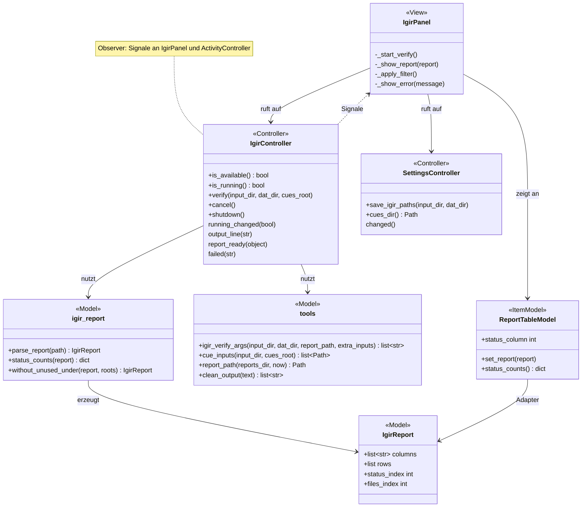
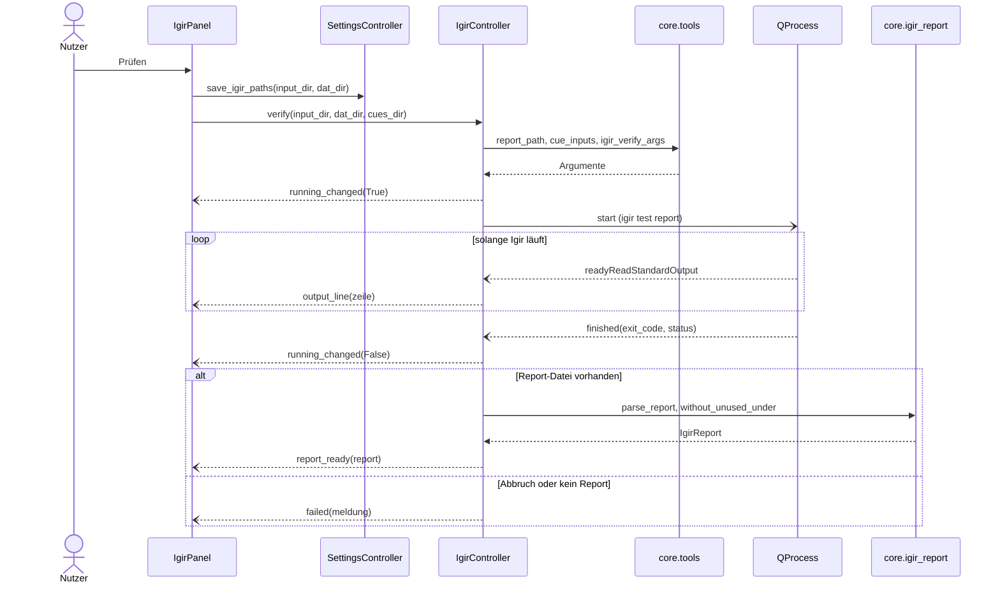

# Igir (Reiter „Igir“)

[Igir](https://github.com/emmercm/igir) gleicht ROM-Dateien per Hash mit DATs ab. Die App nutzt es bisher nur zum **Prüfen mit Report**: Der Nutzer sieht, welche Spiele laut DAT vollständig, fehlend, doppelt oder unbekannt sind – es werden keine Dateien verändert.

Verwandte Docs: [specs/igir.md](../specs/igir.md) · [features/dats.md](dats.md) · [ADR 0005](../adr/0005-external-tools-not-bundled.md)

## Bedienung

- **ROM-Ordner** und **DAT-Ordner** wählen. Beim Start werden die zuletzt verwendeten Ordner eingetragen, eigene Eingaben aber nicht überschrieben. Als DAT-Ordner passt `<HDD>/dats` – Igir liest DATs auch aus Unterordnern. Ist der DAT-Ordner leer, trägt „DATs aktualisieren“ nach Abschluss `<HDD>/dats` ein.
- **Prüfen** merkt sich beide Ordner und startet `igir test report` ([specs/igir.md](../specs/igir.md#prüfen-mit-report)). Die Ausgabe erscheint zeilenweise im Protokoll (höchstens 5000 Zeilen, `MAX_LOG_LINES`), solange es läuft, zeigt ein Balken ohne Prozentangabe die Aktivität.
- **Abbrechen** beendet eine laufende Prüfung (und ebenso ein laufendes „DATs aktualisieren“).
- Danach zeigt die Tabelle den Report mit den Spalten aus Igirs CSV, sortierbar per Klick auf den Kopf; der volle Zelltext steht im Tooltip. Darüber eine Zusammenfassung mit der Anzahl je Status (Bezeichnungen: [specs/igir.md](../specs/igir.md#report-csv)) und ein Filter **Status:** mit „Alle“ und den im Report vorkommenden Status.
- **DATs aktualisieren** lädt die DATs für alle RomM-Plattformen ([features/dats.md](dats.md)).
- Während Igir oder „DATs aktualisieren“ läuft, sind Ordnerwahl, **Prüfen** und **DATs aktualisieren** gesperrt.
- Fehlt die Igir-Programmdatei, zeigt der Reiter oben einen Hinweis mit dem erwarteten Pfad, und **Prüfen** ist gesperrt. Geprüft wird nur beim Aufbau des Reiters.
- Läuft eine Prüfung, steht sie in der [Aktivitätsanzeige](activity.md) („Igir: ROMs prüfen“, Detail = letzte Ausgabezeile).

### Disc-Spiele mit abweichender CUE

Viele Disc-Dumps sind bitgenau korrekt, haben aber eine neu erzeugte oder umbenannte CUE. Igir zählt ein Spiel nur als gefunden, wenn **alle** Dateien laut DAT stimmen, also auch die CUE ([specs/igir.md](../specs/igir.md#erkennung)). Deshalb:

- Die App gibt die korrekten Redump-CUEs aus `<HDD>/dats/redump-cues/` (angelegt von [DATs aktualisieren](dats.md)) als zusätzliches `--input` mit (`tools.cue_inputs`): Heißt der ROM-Ordner wie ein Unterordner dort, also wie ein RomM-Plattform-Slug (z. B. `roms/psx` → `redump-cues/psx`), nur dessen CUEs, sonst alle. Das Protokoll nennt die ergänzten Ordner.
- Unbenutzte Hilfs-CUEs werden danach aus dem Report gefiltert (`igir_report.without_unused_under`), damit sie nicht als „Unbekannt“ erscheinen.
- **Grenze:** Igir kombiniert keine Dateien aus einem Archiv mit Dateien außerhalb. BIN/CUE-Spiele *im Archiv* (7z/ZIP) mit abweichender CUE bleiben „Unbekannt“, bis sie entpackt sind (z. B. im [Archive-Reiter](archive.md)).

Dateinamen spielen für das Finden keine Rolle, nur der Inhalt. Bei Disc-Spielen hängt es indirekt doch am Namen, weil die CUE die Dateinamen der BINs enthält.

## Aufbau

`IgirController` meldet Zustand, Ausgabe, Report und Fehler per Qt-Signal an `IgirPanel` (Observer); `ReportTableModel` ist ein Darstellungsadapter über die Datenklasse `IgirReport`, dessen Spalten aus der CSV-Kopfzeile kommen.

| Schicht | Datei | Rolle |
|---|---|---|
| View | `widgets/igir_panel.py` | `IgirPanel`: Formular, Protokoll, Zusammenfassung, Statusfilter (`QSortFilterProxyModel`), Knopf „DATs aktualisieren“ |
| Item-Model | `widgets/models/report_table_model.py` | `ReportTableModel`: Zeilen und Spalten eines `IgirReport`, Anzahl je Status |
| Controller | `controllers/igir_controller.py` | `IgirController`: Igir als `QProcess`, Ausgabe zeilenweise, Abbruch, Report einlesen |
| Controller | `controllers/settings_controller.py` | `save_igir_paths`, `cues_dir` |
| Model | `core/tools.py` | `igir_executable`, `igir_verify_args`, `cue_inputs`, `report_path`, `clean_output` |
| Model | `core/igir_report.py` | `IgirReport`, `parse_report`, `status_counts`, `without_unused_under` |
| Model | `core/config.py` | `AppConfig.igir_input_dir` / `igir_dat_dir`, `reports_dir` |

## Ablauf

`IgirPanel` übergibt den Report an `ReportTableModel.set_report`, baut Zusammenfassung und Filter neu auf und setzt die Spaltenbreiten.

## Dateien und Ablage

- Igir liest nur, `test` verändert keine Dateien in ROM- oder DAT-Ordner.
- Report: `reports/igir_report_<Datum>_<Zeit>.csv` neben der App (Ordner: [specs/configuration.md](../specs/configuration.md), Dateiname: [specs/igir.md](../specs/igir.md#prüfen-mit-report)). Jede Prüfung legt eine neue Datei an; die App löscht keine Reports.

## Konfiguration

| INI | Bedeutung | Standard |
|---|---|---|
| `[igir] input_dir`, `dat_dir` | zuletzt verwendete Ordner, gespeichert bei **Prüfen** ([specs/configuration.md](../specs/configuration.md)) | leer |

## Fehler und Abbruch

- Vor dem Start: Fehlen ROM- oder DAT-Ordner, ist Igir nicht vorhanden oder lässt sich `reports/` nicht anlegen, erscheint eine Meldung unter den Knöpfen; Igir startet nicht.
- **Abbrechen:** Igir bekommt ein Beenden-Signal und wird nach 3 Sekunden (`CANCEL_GRACE_MS`) hart beendet; Meldung „Die Prüfung wurde abgebrochen.“, ein bereits angezeigter Report bleibt stehen.
- Endet Igir mit Fehlercode, aber mit Report, gilt der Report (Igir meldet z. B. fehlerhafte Dateien per Exit-Code); das Protokoll vermerkt den Fehlercode. Ohne Report erscheint eine Fehlermeldung.
- Startet die Programmdatei nicht oder ist die CSV nicht lesbar, erscheint eine Fehlermeldung.
- Beim Schließen der App wird ein laufendes Igir sofort beendet (`IgirController.shutdown`).

## Status

- **Real getestet:** einige PS1-Spiele als ZIP und als BIN/CUE.
- **Noch offen:** siehe [Roadmap](../roadmap.md#noch-nicht-real-getestet); geplante Themen (z. B. „Nach DAT benennen“) unter [Roadmap – Themen](../roadmap.md#themen).
