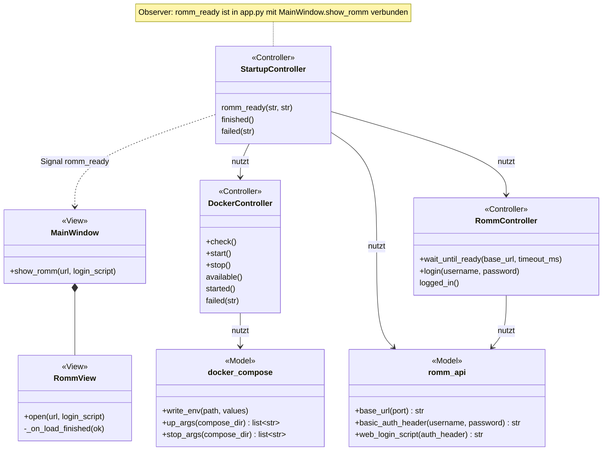
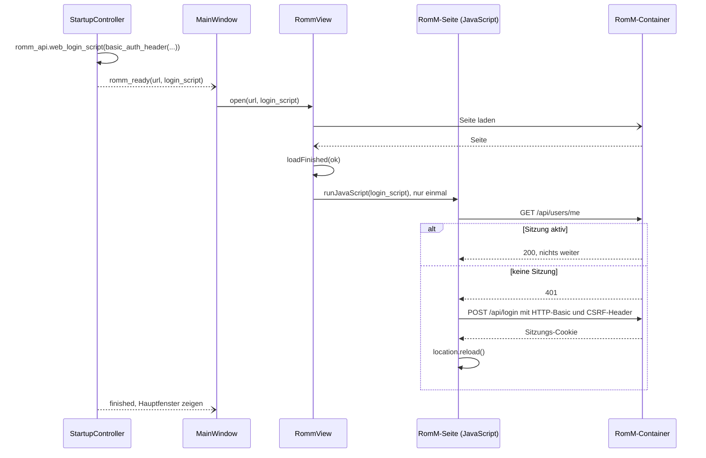

# RomM (Reiter „RomM“)

RomM ist das Herzstück der App ([ADR 0003](../adr/0003-romm-as-core.md)): Es verwaltet die Bibliothek, holt Metadaten und Cover und bietet die Weboberfläche. Der Reiter „RomM“ zeigt diese Oberfläche eingebettet und bereits angemeldet; RomM selbst läuft in Docker, gestartet und gestoppt von der App. Alle Werkzeuge der App richten sich nach der Ordnerstruktur, die RomM erwartet ([specs/library.md](../specs/library.md)).

Verwandte Docs: [features/start.md](start.md) (Start von Docker und RomM, Anmeldung der App) · [specs/romm-api.md](../specs/romm-api.md) · [specs/configuration.md](../specs/configuration.md) · [ADR 0003](../adr/0003-romm-as-core.md) · [ADR 0004](../adr/0004-docker-for-romm.md)

## Bedienung

- Der Reiter „RomM“ ist der erste Reiter des Hauptfensters und zeigt die Weboberfläche von RomM (`http://127.0.0.1:<port>`). Sie wird geladen, sobald der Startablauf abgeschlossen ist.
- **Anmeldung:** Die App meldet die Oberfläche selbst mit dem RomM-Benutzer aus der Einrichtung an – der Nutzer sieht keine Anmeldeseite. Ist aus einem früheren Programmstart noch eine Sitzung aktiv (Cookie im dauerhaften Profil), bleibt sie bestehen.
- Eigene Funktionen der App kommen als zusätzliche Reiter hinzu, nicht als Eingriff in RomM.
- Metadaten-Anbieter (IGDB, ScreenScraper, …) lassen sich direkt in RomM auswählen und einrichten.
- Über die RomM-Oberfläche hochgeladene Dateien landen in `roms/<plattform>/`, werden aber weder gegen DATs geprüft noch umbenannt oder umgepackt (Thema „Bibliothek aufräumen“ in der [Roadmap](../roadmap.md#themen)).
- Nach Änderungen durch die App (z. B. CHD-Umwandlung) muss RomM die Plattform neu einlesen (Scan in RomM).

## Aufbau

Die Verbindung zwischen Controller und Ansicht läuft über Qt-Signale (Observer): `StartupController.romm_ready` ist in `app.py` mit `MainWindow.show_romm` verbunden; die Ansicht kennt keinen Controller.

| Schicht | Datei | Rolle |
|---|---|---|
| View | `widgets/main_window.py` | Erster Reiter, `RommView` im `QStackedWidget`; `show_romm(url, login_script)` gibt an die Ansicht weiter |
| View | `widgets/romm_view.py` | `RommView` (`QWebEngineView`) mit dauerhaftem `QWebEngineProfile` „retro-manager“; führt das Anmeldeskript nach dem ersten erfolgreichen Laden einmal aus |
| Controller | `controllers/startup_controller.py` | Baut nach der Anmeldung der App URL und Anmeldeskript und sendet `romm_ready` ([features/start.md](start.md)) |
| Controller | `controllers/docker_controller.py` | `docker info`, `docker compose up -d` per `QProcess`, `docker compose stop` losgelöst (`QProcess.startDetached`) |
| Controller | `controllers/romm_controller.py` | REST-Anfragen der App selbst (Heartbeat, Admin, Token); siehe [specs/romm-api.md](../specs/romm-api.md) |
| Model | `core/romm_api.py` | `base_url`, `basic_auth_header`, `web_login_script` |
| Model | `core/docker_compose.py` | `.env` schreiben, compose-Argumentlisten (`up_args`, `stop_args`) |
| – | `docker/docker-compose.yml` | RomM-Stack (siehe unten) |

## Ablauf

Docker-Start, Heartbeat, Admin und Anmeldung der App: [features/start.md](start.md#startablauf). Hier der Teil ab der erfolgreichen Anmeldung der App:

Das Anmeldeskript enthält den Basic-Auth-Header; `RommView` hält es nur bis zum ersten erfolgreichen `loadFinished` und leert es dann. Lädt die Seite nicht (`ok` falsch), bleibt das Skript für den nächsten erfolgreichen Ladevorgang erhalten.

## Betrieb in Docker

Festgelegt in `docker/docker-compose.yml` ([ADR 0004](../adr/0004-docker-for-romm.md)):

- Compose-Projektname `retro-manager`, Container `retro-manager-romm` und `retro-manager-romm-db`, beide `restart: unless-stopped`.
- Versionen fest eingetragen: `rommapp/romm:5.4.0` und `mariadb:11.4` (mit Healthcheck; RomM startet erst, wenn die Datenbank gesund ist). Updates bewusst durch Ändern des Tags.
- Port nur lokal: `127.0.0.1:${ROMM_PORT}:8080`.
- Einbindung der HDD: `${ROMM_LIBRARY_PATH}:/romm/library`. Daten von RomM (Datenbank, Ressourcen, Redis, Assets, Konfiguration) liegen in benannten Docker-Volumes und bleiben bei `stop` erhalten.
- Hasheous ist eingeschaltet (`HASHEOUS_API_ENABLED`); IGDB, ScreenScraper, SteamGridDB und RetroAchievements sind über `.env`-Variablen vorbereitet.
- Aufruf immer mit `--project-directory docker/ -f docker/docker-compose.yml` (`docker_compose.compose_args`); Start mit `up -d`, beim Beenden `stop` (nicht `down`).

## Dateien und Ablage

- Profil der Weboberfläche: `webdata/storage/` (Cookies, dauerhaft erzwungen) und `webdata/cache/` neben der App (`config.webdata_dir`).
- Compose-Datei und erzeugte `.env`: `docker/` neben der App (`config.compose_dir`); Inhalt der `.env`: [specs/configuration.md](../specs/configuration.md#dockerenv).
- Bibliothek: `<HDD>` wird als `/romm/library` eingebunden, Struktur in [specs/library.md](../specs/library.md).

## Konfiguration

RomM-Benutzer und Port (`[romm] user`, `port`), Passwort und erzeugte Geheimnisse im Schlüsselbund: [specs/configuration.md](../specs/configuration.md).

## Fehler und Abbruch

- Fehler beim Starten von Docker oder RomM zeigt der Startfehler-Dialog ([features/start.md](start.md#fehler-beim-start)).
- Schlägt die Anmeldung der Oberfläche per Skript fehl, bleibt die Anmeldeseite von RomM sichtbar; eine Meldung in der App gibt es nicht.
- Größere Uploads über die Oberfläche: siehe [specs/romm-api.md](../specs/romm-api.md#hinweise).

## Status

- **Real getestet:** noch nicht festgehalten.
- **Noch offen:** siehe [Roadmap](../roadmap.md#noch-nicht-real-getestet) (nur dort eintragen).
