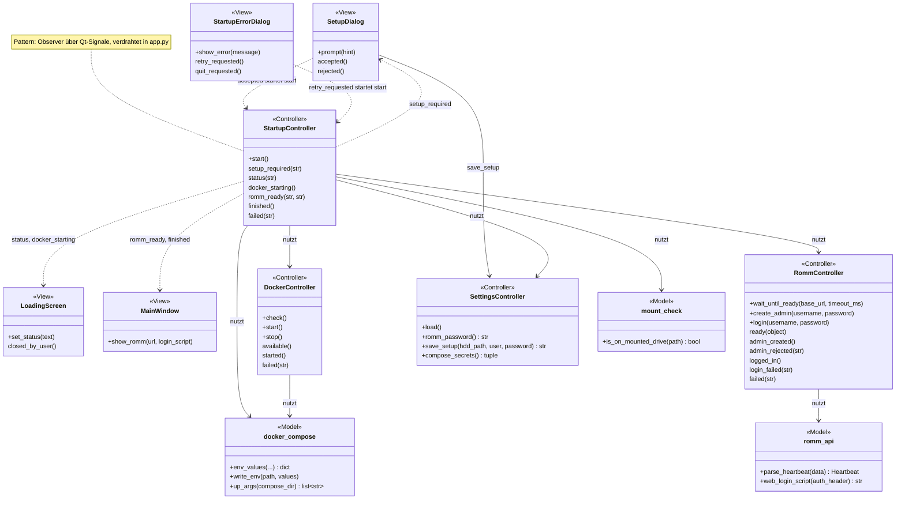
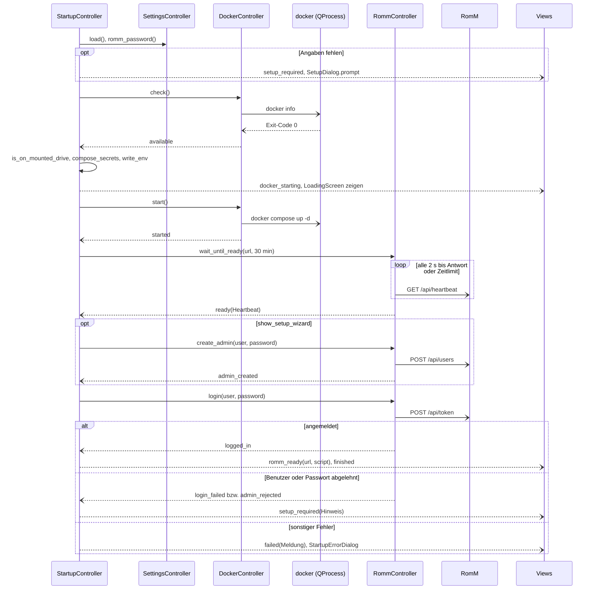

# Start und Einrichtung

Beim Programmstart prüft die App alles, was RomM braucht (Zugangsdaten, Docker, eingehängte HDD), startet RomM in Docker, meldet sich an und öffnet erst dann das Hauptfenster. Fehlende Angaben fragt der Einrichtungsdialog ab, Fehler zeigt ein Dialog mit „Erneut versuchen“.

Verwandte Docs: [specs/configuration.md](../specs/configuration.md) · [specs/romm-api.md](../specs/romm-api.md) · [features/romm.md](romm.md) · [ADR 0004](../adr/0004-docker-for-romm.md)

## Bedienung

- **Startbild** (`SplashScreen`): erscheint sofort und zeigt den aktuellen Schritt; nach 1,5 s (`SPLASH_MIN_DURATION_MS`) beginnt der Startablauf. Es schließt, sobald das nächste Fenster (Einrichtungsdialog, Ladebildschirm, Hauptfenster) oder der Fehlerdialog erscheint.
- **Einrichtungsdialog** (`SetupDialog`), drei Angaben, jeweils mit Info-Symbol (Tooltip) links vor der Beschriftung:
  - **HDD-Ordner** – Wurzel der Bibliothek, wird in RomM als `/romm/library` eingebunden ([features/romm.md](romm.md#betrieb))
  - **RomM-Benutzer** und **RomM-Passwort** – bei einer neuen RomM-Installation legt die App damit den ersten Admin an; das Passwort braucht mindestens 6 Zeichen (`romm_api.MIN_PASSWORD_LENGTH`)
  - HDD-Ordner und Benutzer sind mit den gespeicherten Werten vorbelegt, das Passwortfeld ist immer leer. Über den Feldern steht bei Bedarf ein Hinweistext (z. B. „Bitte alle Felder ausfüllen.“, zu kurzes Passwort, Schlüsselbund nicht erreichbar, Ablehnung durch RomM).
  - **OK** speichert HDD-Ordner und Benutzer in der INI und das Passwort im Schlüsselbund (`SettingsController.save_setup`) und startet den Ablauf neu. **Abbrechen** oder Schließen beendet die App.
  - Zugänge zu Metadaten-Diensten (IGDB, ScreenScraper, Cover-Quellen) fragt der Dialog nicht ab; sie lassen sich direkt in RomM einrichten.
  - Im Entwicklungsbetrieb (Start aus dem Quellcode, `config.is_dev_build()`) zeigt der Dialog oben rechts einen Knopf **Dev**, der Testwerte einträgt (Konstanten `DEV_*` in `widgets/setup_dialog.py`).
- **Ladebildschirm** (`LoadingScreen`): Text des aktuellen Schritts und ein Laufbalken ohne Prozentangabe, solange Docker startet und RomM hochfährt.
- **Startfehler-Dialog** (`StartupErrorDialog`): zeigt die Meldung mit **Erneut versuchen** (Standardknopf, startet den Ablauf von vorn) und **Beenden** (auch per Esc).
- Die App beendet sich nicht automatisch, wenn kurz kein Fenster offen ist (`setQuitOnLastWindowClosed(False)`), sondern nur, wenn der Nutzer Hauptfenster, Ladebildschirm oder Einrichtungsdialog schließt bzw. im Fehlerdialog „Beenden“ wählt.

## Aufbau

`StartupController` führt die Schritte als Kette von Signal-Rückrufen aus (Observer über Qt-Signale): Jeder Schritt startet asynchrone Arbeit in `DockerController` (`QProcess`) oder `RommController` (`QNetworkAccessManager`) und reagiert auf deren Erfolgs- oder Fehlersignal. Alle Objekte erzeugt und verdrahtet `app.py` (Konstruktor-Injektion); die Startfenster kennen den `StartupController` nicht, sondern sind nur über Signale angebunden.

| Schicht | Datei | Rolle |
|---|---|---|
| View | `widgets/splash_screen.py`, `widgets/loading_screen.py` | Startbild, Ladebildschirm mit Statustext |
| View | `widgets/setup_dialog.py` | Einrichtungsdialog, speichert über `SettingsController` |
| View | `widgets/error_dialog.py` | Startfehler-Dialog, Signale `retry_requested`, `quit_requested` |
| View | `widgets/main_window.py` | `show_romm(url, login_script)` lädt die RomM-Oberfläche |
| Controller | `controllers/startup_controller.py` | Ablaufsteuerung, Signale `setup_required`, `status`, `docker_starting`, `romm_ready`, `finished`, `failed` |
| Controller | `controllers/docker_controller.py` | `check()` (`docker info`), `start()` (`compose up -d`), `stop()` (`compose stop`, losgelöst) |
| Controller | `controllers/romm_controller.py` | `wait_until_ready`, `create_admin`, `login` |
| Controller | `controllers/settings_controller.py` | INI laden/speichern, `romm_password`, `compose_secrets` |
| Model | `core/mount_check.py` | `is_on_mounted_drive`: HDD wirklich eingehängt? |
| Model | `core/docker_compose.py` | `.env` schreiben, Docker-Argumentlisten, Geheimnisse erzeugen |
| Model | `core/credentials.py`, `core/config.py` | Schlüsselbund, INI (`AppConfig.is_complete`), `is_dev_build` |
| Model | `core/romm_api.py` | Anfragen/Antworten, `web_login_script` |
| – | `app.py` | Erzeugt alle Objekte, verbindet die Signale, startet den Ablauf per `QTimer.singleShot` |

## Ablauf

1. Konfiguration laden: HDD-Pfad und RomM-Benutzer aus der INI, Passwort aus dem Schlüsselbund. Ist der Schlüsselbund nicht erreichbar → Fehlerdialog.
2. Fehlen HDD-Pfad, Benutzer oder Passwort → **Einrichtungsdialog**; nach „OK“ beginnt der Ablauf bei Schritt 1.
3. Prüfen, ob Docker installiert ist (`docker` im PATH) und läuft (`docker info`).
4. Prüfen, ob die HDD wirklich eingehängt ist – nicht nur, ob der Ordner existiert. Ein leerer Mount-Ordner existiert auch ohne Platte; `mount_check.is_on_mounted_drive` erkennt, dass er dann auf dem Wurzeldateisystem liegt.
5. `docker/.env` schreiben; DB-Passwörter und Auth-Schlüssel erzeugt die App beim ersten Start einmalig und legt sie im Schlüsselbund ab (Inhalt: [specs/configuration.md](../specs/configuration.md#dockerenv)).
6. Ladebildschirm zeigen, `docker compose up -d` asynchron starten.
7. Heartbeat `GET /api/heartbeat` alle 2 s abfragen, bis RomM antwortet; Zeitlimit 30 Minuten (der erste Start braucht wegen Datenbank-Migrationen 15–20 Minuten).
8. Meldet der Heartbeat, dass es noch keinen Admin gibt, legt die App ihn mit den Angaben aus dem Einrichtungsdialog an. Danach Anmeldung der App per Token ([specs/romm-api.md](../specs/romm-api.md)).
9. Hauptfenster zeigen und die RomM-Oberfläche laden; sie wird per Skript automatisch angemeldet ([features/romm.md](romm.md#eingebettete-oberfläche)).

## Dateien und Ablage

- Schreibt `retro-manager.ini` (nur über den Einrichtungsdialog), Geheimnisse in den Schlüsselbund und bei jedem Start `docker/.env` mit Rechten 0600 – Ablageorte: [specs/configuration.md](../specs/configuration.md#ablageorte).

## Konfiguration

Gelesen werden `[archive] hdd_path`, `[romm] user` und `[romm] port` sowie die Schlüsselbund-Einträge `romm_password`, `db_password`, `db_root_password` und `romm_auth_secret_key` ([specs/configuration.md](../specs/configuration.md)). Feste Werte im Code:

| Konstante | Datei | Wert |
|---|---|---|
| `SPLASH_MIN_DURATION_MS` | `app.py` | 1,5 s bis zum Beginn des Ablaufs |
| `HEARTBEAT_INTERVAL_MS` | `controllers/romm_controller.py` | 2 s zwischen Heartbeat-Abfragen |
| `READY_TIMEOUT_MS` | `controllers/startup_controller.py` | 30 Minuten bis RomM bereit sein muss |

## Fehler und Abbruch

- **Startfehler-Dialog** bei: Schlüsselbund nicht erreichbar, Docker nicht installiert oder nicht erreichbar, HDD nicht eingehängt oder Ordner fehlt, `.env` bzw. Geheimnisse nicht schreibbar, `docker compose up -d` gescheitert, Zeitlimit beim Heartbeat, Admin-Anlage mit anderem Fehler als einer Ablehnung, Anmeldung mit unerwartetem HTTP-Status oder ungültiger Antwort. Die Meldung enthält, falls vorhanden, die Fehlerausgabe von Docker bzw. den Fehlertext von RomM. Ladebildschirm und Startbild schließen; der Dialog öffnet sich verzögert (`QTimer.singleShot(0, …)`), damit er nicht innerhalb eines anderen Dialogs aufgeht. Fehler werden zusätzlich geloggt.
- **Zurück zum Einrichtungsdialog** mit Hinweistext: RomM lehnt das neue Admin-Konto ab (HTTP 400/422 mit Fehlertext) oder die Anmeldung scheitert mit HTTP 400/401/403 („Benutzername oder Passwort ist falsch.“).
- **Beenden** (`aboutToQuit`): `docker compose stop` losgelöst (`QProcess.startDetached`), damit es das Beenden der App überdauert – `stop` statt `down`, damit Container und Daten bleiben. Außerdem werden laufende Igir-, chdman-, Archiv- und Export-Vorgänge abgebrochen und Übertragungen beendet.

## Status

- **Real getestet:** Erststart mit Anlage des Admins über den Einrichtungsdialog (Testkonto des Dev-Knopfs).
- **Noch offen:** siehe [Roadmap](../roadmap.md#noch-nicht-real-getestet) (nur dort eintragen)
